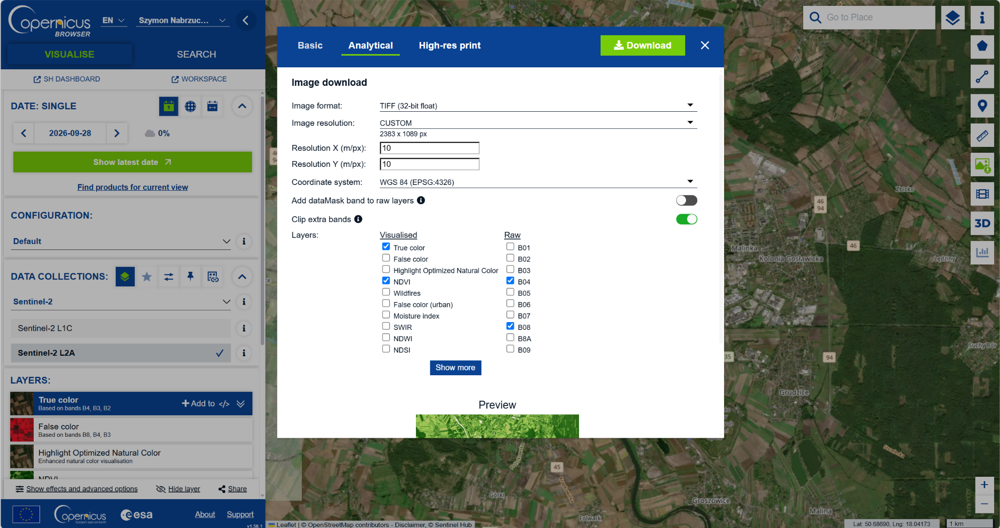
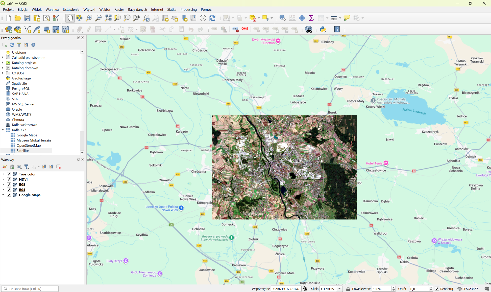
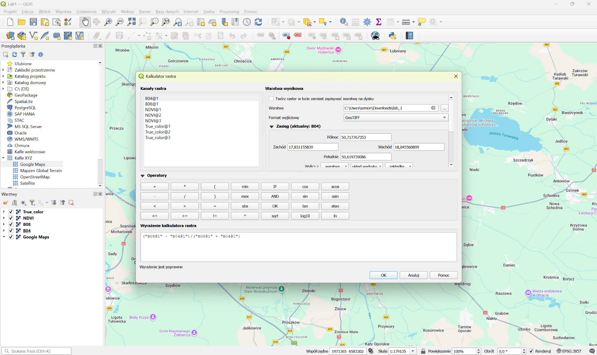
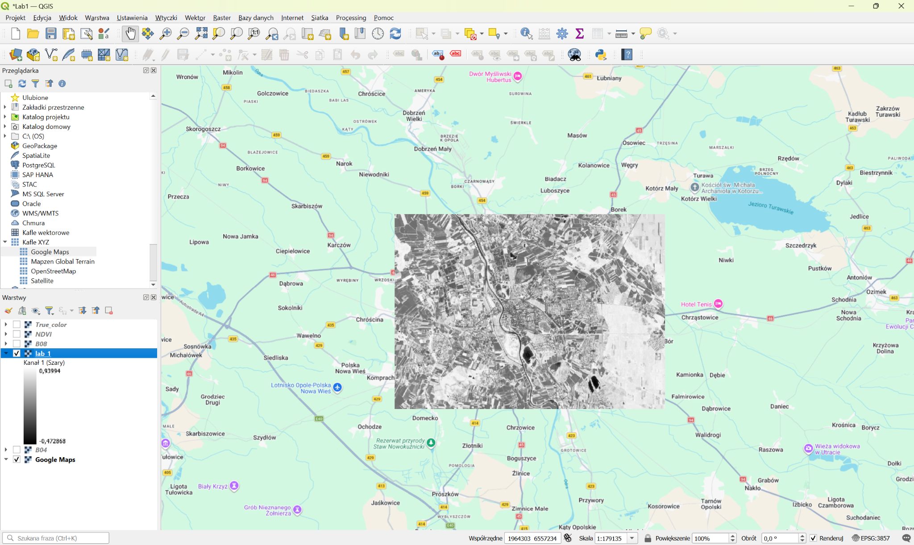
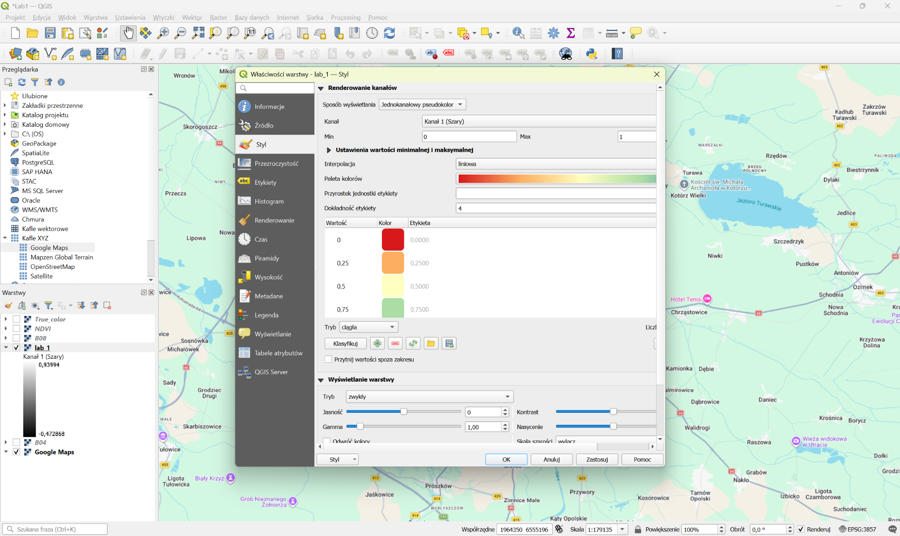
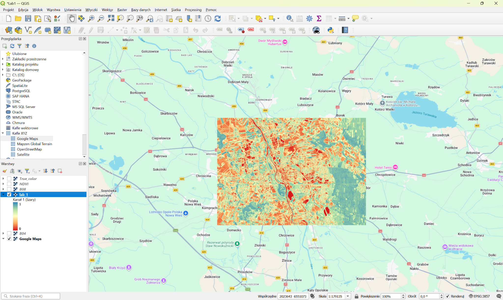

# Laboratorium 1 – Obliczanie wskaźnika NDVI w QGIS

## Cel ćwiczenia

Celem ćwiczenia było obliczenie i wizualizacja wskaźnika NDVI (*Normalized Difference Vegetation Index*) na podstawie zdjęć satelitarnych Sentinel-2. Analiza objęła obszar Opola i okolic. Do przetworzenia danych wykorzystano program **QGIS**.

## Wykorzystane narzędzia i dane

- **QGIS** – wczytanie danych rastrowych, obliczenie wskaźnika i prezentacja wyniku
- **[Copernicus Browser](https://browser.dataspace.copernicus.eu/)** – pobranie obrazu satelitarnego z kolekcji **Sentinel-2 L2A**
- **B04** – kanał czerwony (RED)
- **B08** – kanał bliskiej podczerwieni (NIR)
- **Google Maps** – warstwa podkładowa do orientacji przestrzennej

Wybrano zdjęcie z **28 września 2026 r.** o deklarowanym zachmurzeniu **0%** w Copernicus Browser. Dane wyeksportowano jako **TIFF (32-bit float)** z ustawioną rozdzielczością **10 m/piksel**, wybierając surowe kanały B04 i B08. Dodatkowo pobrano wizualizację True color oraz gotową wizualizację NDVI do porównania.

## Przebieg ćwiczenia

### 1. Pobranie zdjęć satelitarnych

1. Otworzono [Copernicus Browser](https://browser.dataspace.copernicus.eu/) i po zalogowaniu się wybrano obszar Opola.
2. Jako źródło danych wskazano **Sentinel-2 L2A** i wybrano odpowiednią datę.
3. W oknie pobierania przełączono się na zakładkę **Analytical**.
4. Ustawiono format **TIFF (32-bit float)** i rozdzielczość **10 m/piksel**.
5. Zaznaczono surowe kanały **B04** oraz **B08** i pobrano dane.



### 2. Przygotowanie projektu QGIS

1. Utworzono nowy projekt w QGIS.
2. Dodano mapę podkładową **Google Maps** za pomocą zakładki Kafle XYZ.
3. Wczytano pobrane rastry B04 i B08 oraz kompozycję True color.
4. Sprawdzono położenie warstw na tle mapy podkładowej.



### 3. Obliczenie NDVI

Wskaźnik NDVI określa względną aktywność roślinności na podstawie odbicia promieniowania w kanale czerwonym i bliskiej podczerwieni:

$$
NDVI = \frac{NIR - RED}{NIR + RED}
$$

W programie QGIS uruchomiono **Raster → Kalkulator rastra**, a następnie wpisano wyrażenie:

```text
("B08@1" - "B04@1") / ("B08@1" + "B04@1")
```

Wskazano plik wyjściowy GeoTIFF i zatwierdzono operację. Otrzymano jednopasmowy raster NDVI.



### 4. Wizualizacja wyniku

Początkowo warstwa wynikowa była wyświetlana w skali szarości.



Aby zwiększyć czytelność wyniku, otworzono **Właściwości warstwy → Styl** i zmieniono sposób renderowania na **Jednokanałowy pseudokolor** (*Singleband pseudocolor*). Następnie zastosowano paletę barw przechodzącą od czerwieni i pomarańczu do zieleni.



### 5. Uzyskana mapa NDVI

Na wynikowej mapie można odróżnić obszary o różnym pokryciu roślinnością. Zgodnie z przyjętą paletą zieleń odpowiada wyższym wartościom wskaźnika, natomiast barwy czerwone i pomarańczowe – niższym wartościom.



## Wnioski

Analiza wskaźnika NDVI pozwoliła zaobserwować wyraźne różnice w pokryciu roślinnością na terenie Opola i okolic. Najwyższe wartości wskaźnika występowały głównie na obszarach leśnych oraz terenach pokrytych gęstą roślinnością, natomiast niższe wartości były charakterystyczne dla obszarów zabudowanych, dróg i zbiorników wodnych.

Na uzyskanej mapie widoczne były również różnice pomiędzy poszczególnymi terenami rolniczymi, co może wynikać z rodzaju upraw, ich aktualnego stanu oraz terminu wykonania zdjęcia satelitarnego. Wartości NDVI zależą bowiem nie tylko od obecności roślinności, ale również od jej kondycji i fazy rozwoju.

Wyniki pokazują, że wskaźnik NDVI jest przydatnym narzędziem do oceny rozmieszczenia i aktywności roślinności na dużych obszarach. Należy jednak pamiętać, że sam wskaźnik nie pozwala jednoznacznie określić rodzaju pokrycia terenu ani przyczyny niskich wartości. Do dokładniejszej analizy konieczne byłoby uwzględnienie dodatkowych danych lub zdjęć satelitarnych z różnych terminów.