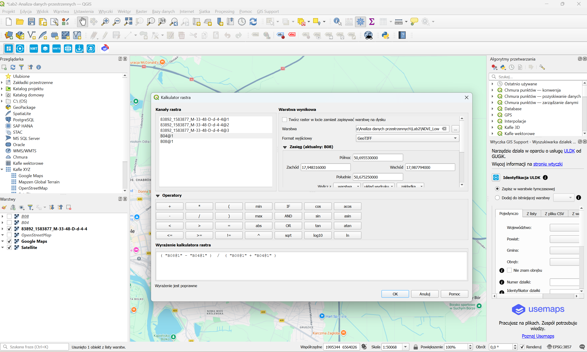
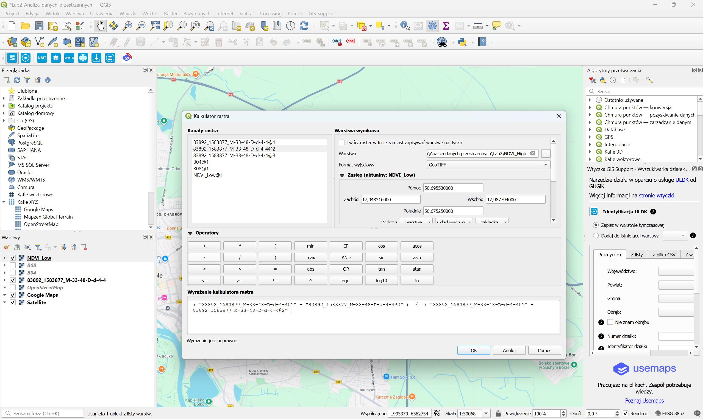
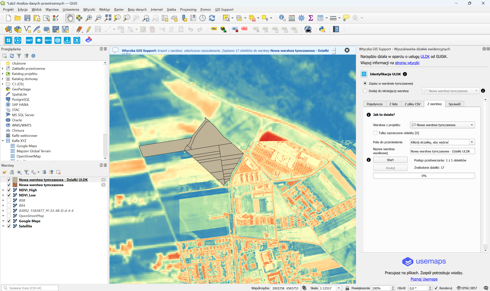
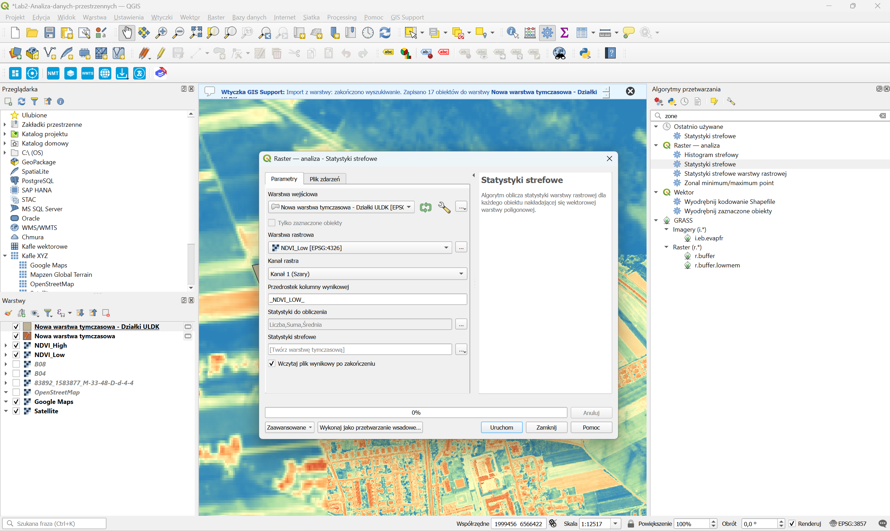
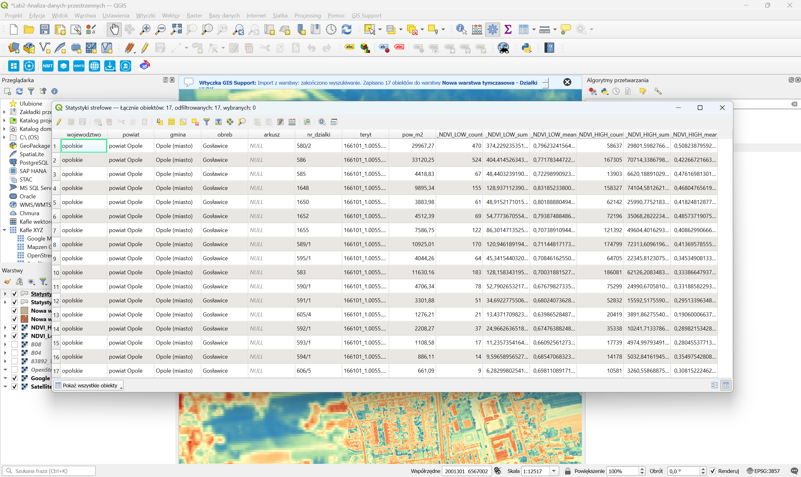
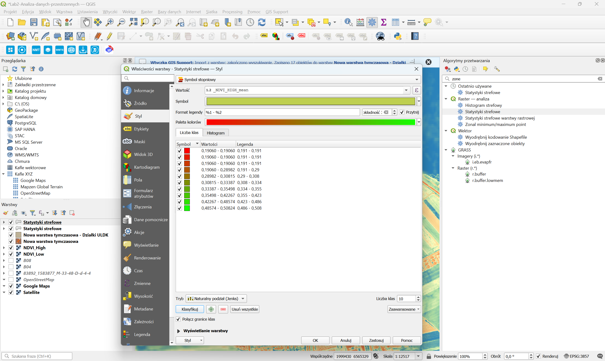
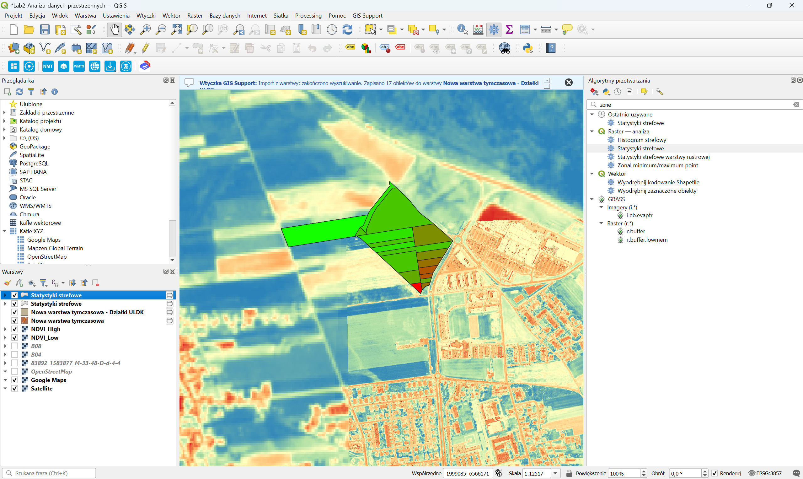

# Laboratorium 2 – Analiza wskaźnika NDVI dla działek ewidencyjnych w QGIS

## Cel ćwiczenia

Celem ćwiczenia było przeprowadzenie analizy przestrzennej z wykorzystaniem programu **QGIS**, polegającej na obliczeniu i porównaniu wartości wskaźnika NDVI (*Normalized Difference Vegetation Index*) dla wybranych działek ewidencyjnych na terenie Opola.

W ramach laboratorium przygotowano dwa rastry NDVI na podstawie danych satelitarnych oraz ortofotomapy CIR. Następnie pozyskano granice działek ewidencyjnych za pomocą usługi ULDK i przeprowadzono analizę statystyk strefowych, umożliwiającą obliczenie średnich wartości NDVI dla poszczególnych działek.

## Wykorzystane narzędzia i dane

- **QGIS** – przetwarzanie, analiza i wizualizacja danych przestrzennych
- **Copernicus Browser** – pozyskanie zobrazowań satelitarnych Sentinel-2 L2A
- **Geoportal Krajowy** – pozyskanie ortofotomapy CIR
- **Kalkulator rastra** – obliczenie wskaźników NDVI
- **GIS Support / ULDK** – pozyskanie granic działek ewidencyjnych
- **Statystyki strefowe** – obliczenie statystyk NDVI dla działek
- **Google Maps / OpenStreetMap / Satellite** – podkłady mapowe
- **ChatGPT** – pomoc w formatowaniu sprawozdania

## Przebieg ćwiczenia

### 1. Pozyskanie i przygotowanie danych

W pierwszym etapie pozyskano dane rastrowe dla wybranego obszaru Opola.

Za pomocą platformy **Copernicus Browser** pobrano zobrazowania satelitarne Sentinel-2 L2A z dnia 15 czerwca 2025 r. Wybrano kanały spektralne B04 (światło czerwone) oraz B08 (bliska podczerwień), niezbędne do obliczenia wskaźnika NDVI.

Dodatkowo z **Geoportalu Krajowego** pozyskano ortofotomapę CIR (*Color Infrared*) z dnia 13 czerwca 2025r.

Pobrane dane zaimportowano do programu QGIS, a następnie wykorzystano do przygotowania dwóch warstw rastrowych: `NDVI_Low` oraz `NDVI_High`.

### 2. Obliczenie wskaźnika NDVI na podstawie danych Sentinel-2

Do obliczenia wskaźnika NDVI wykorzystano narzędzie **Kalkulator rastra**.

Wskaźnik oblicza się według wzoru:

**NDVI = (NIR − RED) / (NIR + RED)**

gdzie:
- **NIR** – odbicie promieniowania w zakresie bliskiej podczerwieni,
- **RED** – odbicie promieniowania w zakresie światła czerwonego.

W przypadku danych Sentinel-2 zastosowano wyrażenie:

```text
("B08@1" - "B04@1") / ("B08@1" + "B04@1")
```

Otrzymany raster zapisano jako `NDVI_Low.tif`.

Wartości NDVI mieszczą się w przedziale od -1 do 1. Wyższe wartości zazwyczaj wskazują na obecność intensywnej roślinności, natomiast wartości niskie lub ujemne mogą odpowiadać obszarom pozbawionym roślinności, zabudowie lub wodzie.



*Rys. 1. Obliczenie wskaźnika NDVI na podstawie kanałów B08 i B04 z danych Sentinel-2.*

### 3. Obliczenie NDVI na podstawie ortofotomapy CIR

W kolejnym etapie wykorzystano pobraną z Geoportalu ortofotomapę CIR.

W kalkulatorze rastra zastosowano analogiczny wzór NDVI, wykorzystując pierwszy i drugi kanał ortofotomapy CIR, odpowiadające pasmom NIR i RED.

Wynik zapisano jako `NDVI_High.tif`.

Przygotowanie drugiego rastra umożliwiło przeprowadzenie analizy tego samego obszaru z wykorzystaniem danych o wyższej rozdzielczości przestrzennej.



*Rys. 2. Obliczenie wskaźnika NDVI na podstawie kanałów ortofotomapy CIR.*

### 4. Pozyskanie działek ewidencyjnych

Następnie wykorzystano wtyczkę **GIS Support**, umożliwiającą wyszukiwanie działek ewidencyjnych za pośrednictwem usługi ULDK udostępnianej przez Główny Urząd Geodezji i Kartografii.

Wybrano obszar obejmujący grunty położone w obrębie miasta **Opole**.

Za pomocą narzędzia wyszukiwania działek pozyskano **17 obiektów wektorowych**, reprezentujących działki ewidencyjne. Zostały one zapisane w warstwie tymczasowej i wyświetlone na tle rastra NDVI.

Pozyskane dane zawierały między innymi numery działek, identyfikatory ewidencyjne oraz informacje o ich powierzchni.



*Rys. 3. Pozyskanie granic 17 działek ewidencyjnych za pomocą usługi ULDK.*

### 5. Obliczenie statystyk strefowych

Po przygotowaniu warstw rastrowych i wektorowych wykorzystano narzędzie **Statystyki strefowe**.

Jako warstwę wektorową wskazano pozyskane działki ewidencyjne, natomiast jako warstwy rastrowe wykorzystano kolejno `NDVI_Low` oraz `NDVI_High`.

Dla każdej działki obliczono trzy parametry:

- **Liczba** – liczbę pikseli rastra uwzględnionych w analizie
- **Suma** – sumę wartości NDVI analizowanych pikseli
- **Średnia** – średnią wartość NDVI w granicach działki

Analizę przeprowadzono osobno dla obu rastrów. Otrzymane wyniki zapisano w tabeli atrybutów, wykorzystując przedrostki `_NDVI_LOW_` oraz `_NDVI_HIGH_`.



*Rys. 4. Konfiguracja narzędzia statystyk strefowych dla analizowanych działek.*

### 6. Analiza i porównanie wyników

Po wykonaniu obliczeń przeanalizowano tabelę atrybutów zawierającą wyniki statystyk strefowych dla 17 działek ewidencyjnych.

W tabeli znajdowały się zarówno informacje o działkach, jak i obliczone wartości NDVI z obu rastrów.

Na podstawie otrzymanych wyników zaobserwowano różnice pomiędzy wartościami średniego NDVI wyznaczonymi na podstawie danych Sentinel-2 oraz ortofotomapy CIR.

Przykładowe wyniki zaokrąglone do 4 miejsc po przecinku przedstawiono poniżej:

| Numer działki | NDVI_Low (średnia) | NDVI_High (średnia) |
|---|---:|---:|
| 580/2 | 0,7962 | 0,5082 |
| 586 | 0,7718 | 0,4227 |
| 585 | 0,7230 | 0,4762 |
| 1648 | 0,8319 | 0,4680 |
| 1650 | 0,8019 | 0,4182 |
| 1652 | 0,7939 | 0,4857 |
| 1655 | 0,7074 | 0,4086 |

W analizowanym zbiorze wartości średniego NDVI dla danych Sentinel-2 były wyższe niż wartości otrzymane z ortofotomapy CIR.

Różnice mogą wynikać z różnych terminów wykonania zobrazowań oraz z wyższej dokładności obliczania wartości NDVI z ortofotomapy CIR.

W przypadku rastra o wyższej rozdzielczości liczba pikseli uwzględnianych w granicach działek była znacznie większa, co mogło przełożyć się na dokładniejszy wynik.



*Rys. 5. Tabela atrybutów z wynikami statystyk strefowych dla obu rastrów NDVI.*

### 7. Wizualizacja wyników

W ostatnim etapie przygotowano wizualizację wyników analizy w programie QGIS.

W tym celu wykorzystano stylizację **Symbol stopniowy**, umożliwiającą przedstawienie działek za pomocą różnych kolorów na podstawie wartości wybranego atrybutu.

Jako podstawę klasyfikacji wykorzystano średnią wartość NDVI dla poszczególnych działek.

Zastosowano tryb **Naturalny podział (Jenks)** oraz skalę kolorystyczną od czerwonego do zielonego, gdzie kolor czerwony odpowiadał niższym wartościom NDVI, natomiast zielony wartościom wyższym i ustalono podział na 10 klas.



*Rys. 6. Konfiguracja klasyfikacji kolorystycznej działek na podstawie średniej wartości NDVI.*

Wyniki przedstawiono na mapie, na której widoczne są działki ewidencyjne na tle rastra NDVI.

Zastosowana wizualizacja umożliwia porównanie wartości wskaźnika pomiędzy poszczególnymi działkami oraz identyfikację obszarów o niższej i wyższej wartości NDVI.



*Rys. 7. Końcowa wizualizacja wartości NDVI dla analizowanych działek ewidencyjnych.*

## Wnioski

W ramach laboratorium przeprowadzono analizę przestrzenną z wykorzystaniem danych rastrowych i wektorowych w programie QGIS.

Na podstawie zobrazowań Sentinel-2 oraz ortofotomapy CIR przygotowano dwa rastry NDVI, a następnie pozyskano granice 17 działek ewidencyjnych za pomocą usługi ULDK.

Wykorzystanie statystyk strefowych umożliwiło wyznaczenie średnich wartości NDVI dla każdej działki i porównanie wyników uzyskanych z obu źródeł danych.

Zaobserwowano różnice pomiędzy wartościami wskaźnika uzyskanymi z danych satelitarnych i ortofotomapy, co wskazuje na znaczenie rozdzielczości przestrzennej, charakterystyki zobrazowań i terminów ich pozyskania.

Ćwiczenie pokazało możliwości wykorzystania programu QGIS do łączenia danych pochodzących z różnych źródeł oraz przeprowadzania analiz przestrzennych na podstawie danych rastrowych i wektorowych.