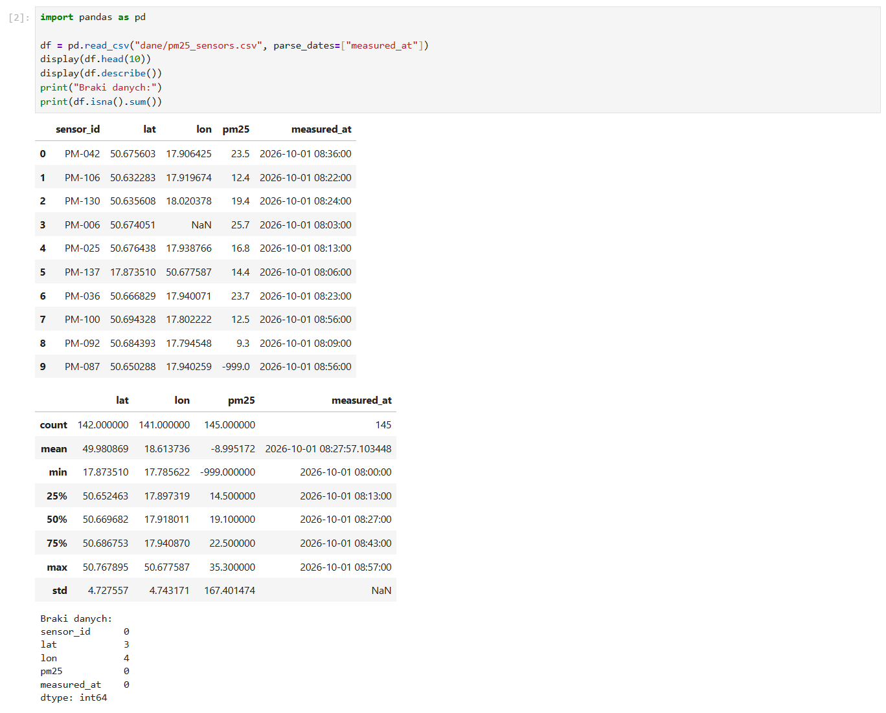
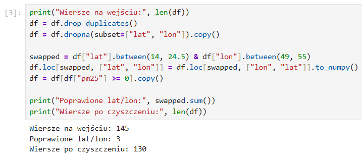
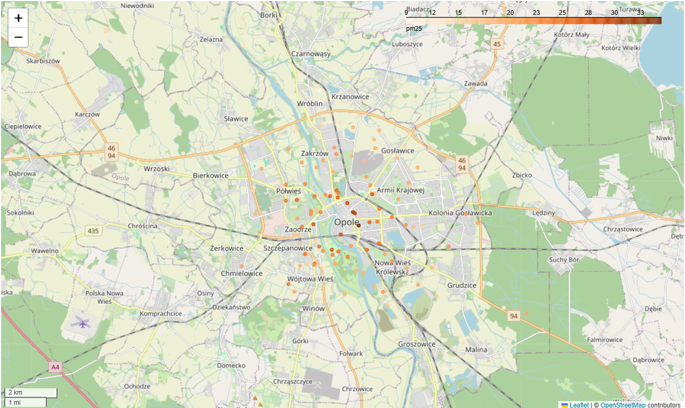
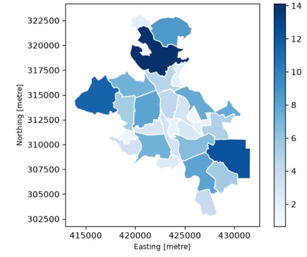
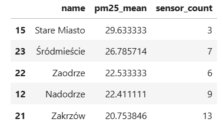
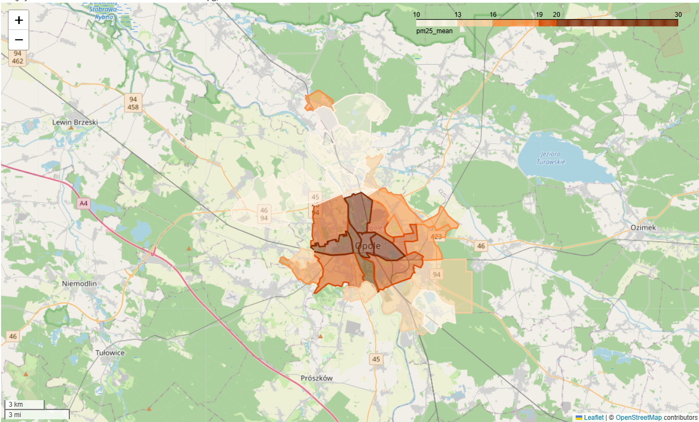
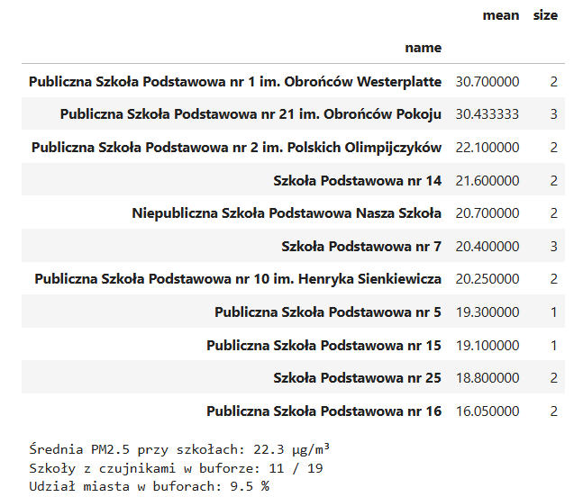
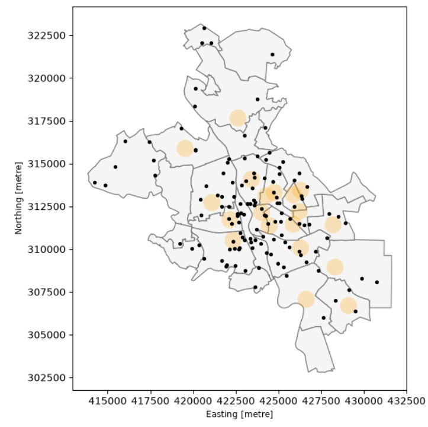
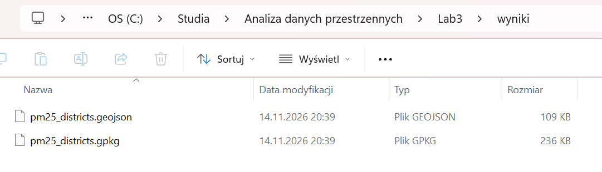

# Laboratorium 3 – GeoPandas: analiza danych wektorowych

## Cel ćwiczenia

Celem ćwiczenia było zapoznanie się z tworzeniem i analizą danych przestrzennych za pomocą biblioteki **GeoPandas**. Wczytano dane o stężeniu pyłu PM2.5 z czujników w Opolu, wykryto i poprawiono błędy, a następnie utworzono obiekty `GeoDataFrame` oraz przedstawiono pomiary na interaktywnej mapie.

W dalszej części ćwiczenia przeprowadzono analizę przestrzenną, której celem było ustalenie, **które dzielnice Opola mają najwyższe średnie stężenie PM2.5 oraz jak wygląda sytuacja w pobliżu szkół podstawowych**. W tym celu wykorzystano granice dzielnic, lokalizacje szkół, złączenia przestrzenne i bufory o promieniu 500 m. Wyniki zapisano w formatach umożliwiających ich dalszą analizę w programach GIS.

## Wykorzystane narzędzia i dane

- **Jupyter Notebook** – wykonanie kodu i analiza wyników
- **pandas** – wczytywanie, czyszczenie i zestawianie danych tabelarycznych
- **GeoPandas** – tworzenie i analiza danych wektorowych, transformacje układów współrzędnych, złączenia przestrzenne i eksport wyników
- **Shapely** – reprezentacja geometrii i operacje przestrzenne, w tym tworzenie buforów
- **Matplotlib / Folium** – wizualizacja wyników na mapach statycznych i interaktywnych
- **`pm25_sensors.csv`** – syntetyczne odczyty PM2.5 z czujników w Opolu, zawierające celowo wprowadzone błędy
- **`opole_districts.geojson`** – granice dzielnic Opola
- **`opole_schools.geojson`** – lokalizacje szkół podstawowych
- **ChatGPT** – pomoc w redakcji i formatowaniu sprawozdania

## Przebieg ćwiczenia

### 1. Utworzenie obiektu GeoDataFrame

Na początku zapoznano się ze strukturą `GeoDataFrame`, który łączy dane tabelaryczne z kolumną zawierającą geometrie obiektów przestrzennych. Za pomocą biblioteki Shapely utworzono dwa przykładowe punkty, a następnie zapisano je w obiekcie GeoDataFrame wraz z nazwami.

### 2. Wczytanie surowych danych

Za pomocą funkcji `read_csv()` z biblioteki pandas wczytano plik `pm25_sensors.csv`. Zbiór zawierał **145 rekordów** i pięć kolumn: `sensor_id`, `lat`, `lon`, `pm25` oraz `measured_at`.

Wyświetlono pierwsze 10 rekordó, statystyki opisowe oraz liczbę brakujących wartości. Wykryto 3 braki w kolumnie `lat` i 4 w `lon`. W danych występowały również duplikaty, rekordy z zamienionymi współrzędnymi i wartość `-999`, oznaczająca błędny odczyt czujnika. Z tego powodu dane wymagały oczyszczenia przed analizą.

*Rys. 1. Podgląd surowych danych pomiarowych PM2.5 oraz statystyk i brakujących wartości.*

### 3. Czyszczenie danych

Czyszczenie wykonano etapowo. Najpierw usunięto **5 zduplikowanych rekordów**, a następnie **6 wierszy bez kompletnych współrzędnych**. W kolejnym kroku poprawiono **3 rekordy**, w których zamieniono miejscami szerokość i długość geograficzną. Wykorzystano do tego zakresy współrzędnych dla Polski.

Na końcu usunięto **4 rekordy z błędnymi odczytami PM2.5**. Liczba wierszy zmniejszyła się z **145 do 130**. Poprawione dane wykorzystano w kolejnych etapach ćwiczenia.

*Rys. 2. Wyniki czyszczenia danych.*

### 4. Utworzenie warstwy punktowej czujników

Oczyszczone dane tabelaryczne przekształcono w `GeoDataFrame`. Geometrie punktowe utworzono funkcją `gpd.points_from_xy(df["lon"], df["lat"])`, a warstwie przypisano układ EPSG:4326.

Następnie za pomocą metody `explore()` przygotowano interaktywną mapę. Punkty przedstawiały lokalizacje czujników, natomiast ich kolor zależał od wartości PM2.5. Wizualizacja umożliwiła sprawdzenie rozmieszczenia pomiarów na obszarze Opola.

*Rys. 3. Rozmieszczenie czujników PM2.5 na interaktywnej mapie Opola.*

### 5. Zmiana układu współrzędnych (CRS)

W kolejnym etapie porównano sposób wyznaczania odległości w różnych układach współrzędnych. Układ **EPSG:4326** przechowuje współrzędne w stopniach geograficznych, dlatego nie nadaje się do bezpośredniego obliczania odległości w metrach.

Warstwę czujników przekształcono metodą `to_crs()` do układu **EPSG:2180 (PUWG 1992)**. Dla dwóch przykładowych punktów odległość w układzie geograficznym wynosiła około **0,0453°**, a w układzie metrycznym około **4906 m**. Transformacja była niezbędna do dalszych obliczeń powierzchni i tworzenia buforów wokół szkół.

### 6. Wczytanie granic dzielnic Opola

Z pliku `opole_districts.geojson` wczytano warstwę poligonową przedstawiającą dzielnice Opola. Po przekształceniu danych do EPSG:2180 obliczono powierzchnię każdego poligonu w kilometrach kwadratowych.

Łączna powierzchnia analizowanych poligonów wyniosła około **148,8 km²**. Największe powierzchnie miały **Czarnowąsy (14,12 km²)**, **Grudzice (12,34 km²)** oraz **Wrzoski (11,46 km²)**. Wyniki zwizualizowano na mapie, stosując zróżnicowaną kolorystykę odpowiadającą powierzchni dzielnic.

*Rys. 4. Mapa dzielnic Opola z przedstawieniem ich powierzchni w km².*

### 7. Analiza PM2.5 w poszczególnych dzielnicach

Następnie wykonano **złączenie przestrzenne** (`sjoin()`) z warunkiem `within`, które pozwoliło przypisać pomiary do dzielnic, w których znajdowały się czujniki. Za pomocą grupowania obliczono średnie stężenie PM2.5 oraz liczbę przypisanych czujników dla każdej dzielnicy.

Najwyższe średnie wartości uzyskano dla następujących dzielnic:

| Dzielnica | Średnie PM2.5 (µg/m³) | Liczba czujników |
|---|---:|---:|
| Stare Miasto | 29,63 | 3 |
| Śródmieście | 26,79 | 7 |
| Zaodrze | 22,53 | 6 |
| Nadodrze | 22,41 | 9 |
| Zakrzów | 20,75 | 13 |

**Najwyższe średnie stężenie PM2.5 odnotowano na Starym Mieście (29,63 µg/m³)**. Wynik ten opierał się jednak tylko na trzech czujnikach, dlatego przy jego interpretacji należy uwzględnić niewielką liczbę pomiarów.

*Rys. 5. Zestawienie dzielnic o najwyższym średnim stężeniu PM2.5.*

Otrzymane wyniki przedstawiono także na mapie tematycznej, na której kolor poszczególnych dzielnic odpowiadał średniej wartości PM2.5. Pozwoliło to zobrazować przestrzenne różnice pomiędzy analizowanymi obszarami.

*Rys. 6. Przestrzenne zróżnicowanie średniego stężenia PM2.5 w dzielnicach Opola.*

### 8. Analiza PM2.5 w pobliżu szkół

W kolejnym etapie wczytano plik `opole_schools.geojson` zawierający lokalizacje szkół podstawowych. Warstwę przekształcono do układu EPSG:2180, a wokół każdej szkoły utworzono **bufor o promieniu 500 m** przy użyciu metody `buffer()`.

Za pomocą złączenia przestrzennego sprawdzono, które czujniki znajdują się wewnątrz wyznaczonych buforów. Następnie obliczono średnie stężenie PM2.5 oraz liczbę czujników przypisanych do otoczenia poszczególnych szkół.

Spośród **19 szkół** czujniki w promieniu 500 m znajdowały się w pobliżu **11 placówek**. Średnia wartość PM2.5 dla odczytów przypisanych do buforów wyniosła około **22,3 µg/m³**. Najwyższe średnie wartości odnotowano przy następujących szkołach:

| Szkoła | Średnie PM2.5 (µg/m³) | Liczba czujników |
|---|---:|---:|
| Publiczna Szkoła Podstawowa nr 1 | 30,70 | 2 |
| Publiczna Szkoła Podstawowa nr 21 | 30,43 | 3 |
| Publiczna Szkoła Podstawowa nr 2 | 22,10 | 2 |
| Szkoła Podstawowa nr 14 | 21,60 | 2 |
| Niepubliczna Szkoła Podstawowa Nasza Szkoła | 20,70 | 2 |

*Rys. 7. Średnie wartości PM2.5 w promieniu 500 m od szkół podstawowych.*

Po połączeniu nakładających się buforów ich powierzchnia stanowiła około **9,5% powierzchni analizowanego obszaru miasta**. Wyniki przedstawiono na mapie z zaznaczonymi strefami wokół szkół i lokalizacjami czujników.

*Rys. 8. Bufory o promieniu 500 m wokół szkół i rozmieszczenie czujników PM2.5.*

Należy pamiętać, że pojedynczy czujnik mógł znajdować się w buforach kilku szkół, a brak czujnika w danym buforze nie oznacza braku zanieczyszczenia powietrza.

### 9. Eksport wyników

W ostatnim etapie wyeksportowano przygotowane warstwy do formatów wykorzystywanych w systemach informacji geograficznej.

W pliku `pm25_districts.gpkg` zapisano dwie warstwy: `districts`, zawierającą granice dzielnic wraz ze statystykami PM2.5, oraz `sensors`, reprezentującą czujniki. Dodatkowo warstwę dzielnic zapisano jako `pm25_districts.geojson` w układzie EPSG:4326.

Pliki umieszczono w folderze `wyniki`, dzięki czemu można je później otworzyć i wykorzystać do dalszej analizy, np. w programie QGIS.

*Rys. 9. Pliki GeoPackage i GeoJSON zapisane po zakończeniu analizy.*

## Wnioski

W ramach laboratorium przeprowadzono analizę danych przestrzennych z wykorzystaniem bibliotek pandas, GeoPandas i Shapely. Na podstawie syntetycznych odczytów PM2.5 z Opola przygotowano warstwę punktową czujników, a następnie połączono ją z granicami dzielnic i lokalizacjami szkół.

W wyniku czyszczenia danych liczba rekordów zmniejszyła się ze **145 do 130**. Poprawienie błędnych współrzędnych oraz usunięcie nieprawidłowych pomiarów pozwoliło przygotować dane do dalszej analizy.

Analiza dzielnic wykazała, że **najwyższe średnie stężenie PM2.5 występowało na Starym Mieście (29,63 µg/m³)**, a następnie w Śródmieściu (26,79 µg/m³). W przypadku szkół stwierdzono obecność czujników w promieniu 500 m od **11 z 19 placówek**, przy czym najwyższe wartości uzyskano w otoczeniu Publicznych Szkół Podstawowych nr 1 i 21.

Ćwiczenie pokazało możliwości wykorzystania GeoPandas do przetwarzania danych wektorowych, wykonywania transformacji układów współrzędnych, złączeń przestrzennych i analiz buforowych.