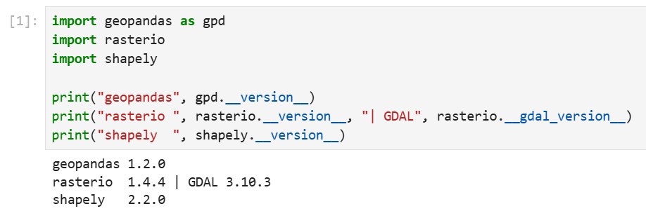
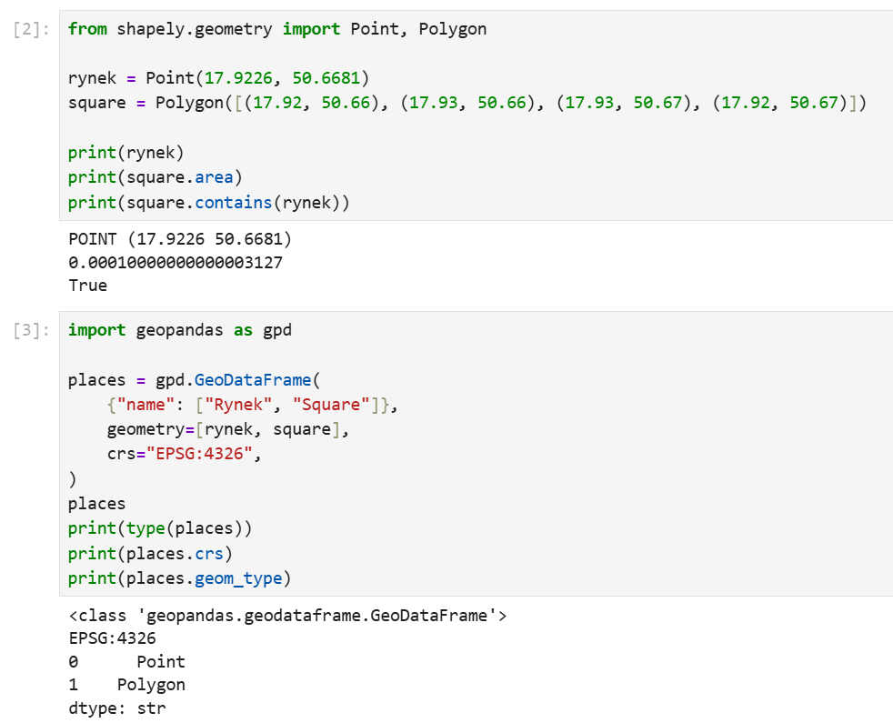
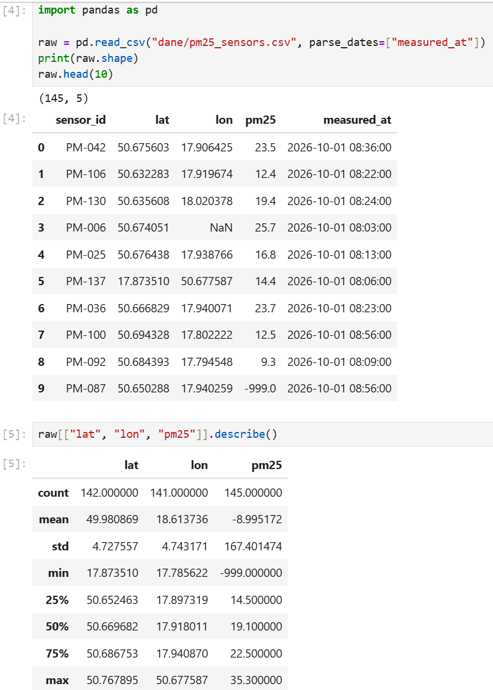
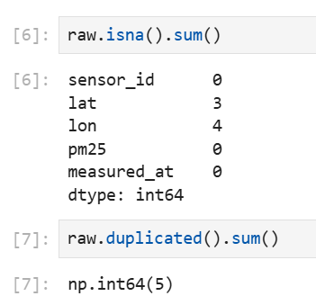
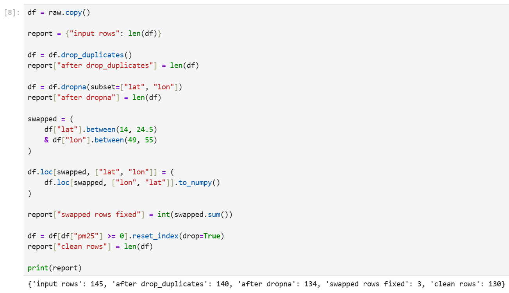
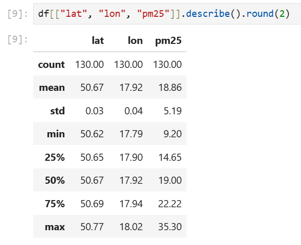
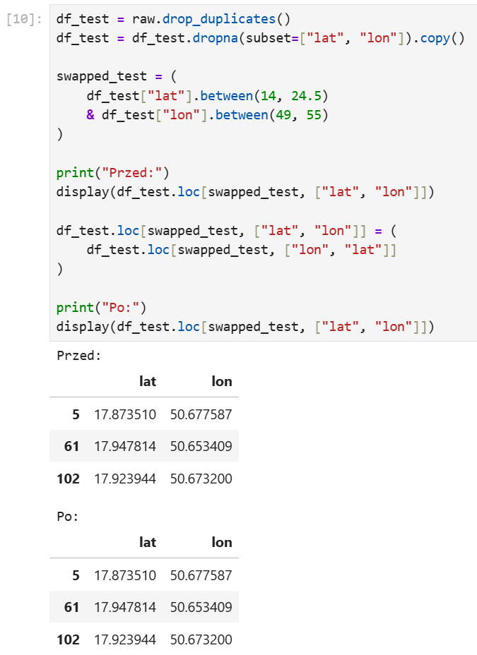
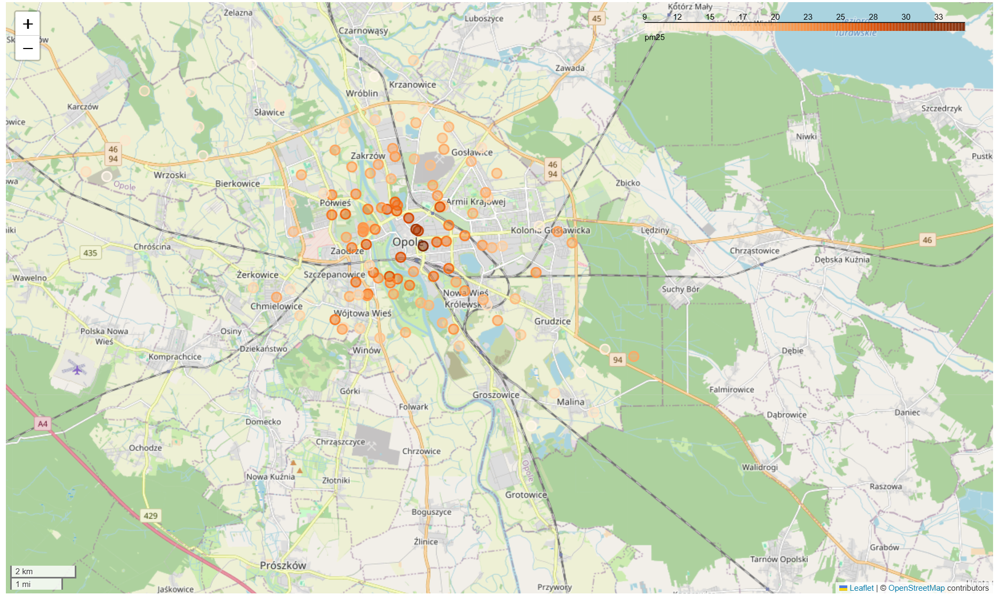
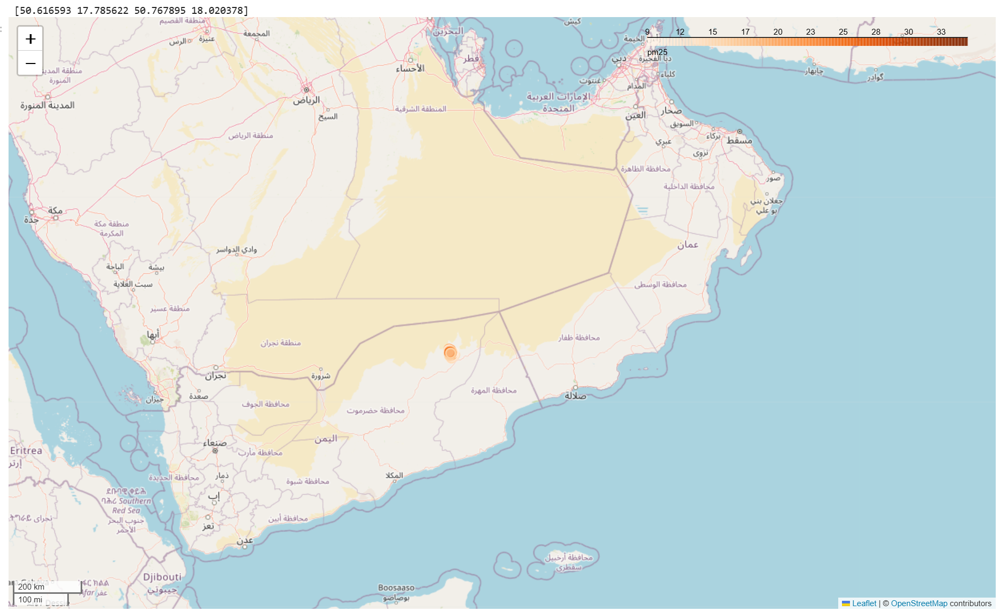

# Laboratorium 3 – GeoPandas

## Cel ćwiczenia

Celem ćwiczenia było zapoznanie się z tworzeniem i analizą danych przestrzennych za pomocą m.in. bibliotki GeoPandas. Wczytano dane o stężeniu pyłu PM2.5 w Opolu, następnie wykryto i poprawiono błędy, po czym utworzono obiekty GeoDataFrame oraz przedstawiono wyniki na mapie interaktywnej. Sprawdzono również wpływ nieprawidłowej kolejności współrzędnych geograficznych na lokalizację obiektów.

## Wykorzystane narzędzia i dane

- **Jupyter Notebook** – wykonywanie kodu i analiza danych
- **GeoPandas** – obsługa danych przestrzennych
- **Shapely** – tworzenie i badanie geometrii
- **pandas** – odczyt i czyszczenie tabel
- **Rasterio** – biblioteka sprawdzona podczas przygotowania środowiska i przewidziana do użycia w następnym laboratorium
- **`pm25_sensors.csv`** – syntetyczne odczyty pyłu PM2.5 z czujników w Opolu, celowo zawierające błędy
- **ChatGPT** – pomoc w formatowaniu sprawozdania

## Przebieg ćwiczenia

### 1. Przygotowanie środowiska

Sprawdzono możliwość importowania bibliotek GeoPandas, Rasterio i Shapely oraz odczytano ich wersje. Uzyskano odpowiednio 1.2.0, 1.4.4 i 2.2.0.

### 2. Tworzenie geometrii i GeoDataFrame

Za pomocą Shapely utworzono punkt reprezentujący Rynek w Opolu o współrzędnych (17.9226, 50.6681) i prostokątny wielokąt. Pole wielokąta wyniosło około 0.0001 stopnia kwadratowego. Metoda `contains()` zwróciła `True`, co potwierdziło położenie punktu wewnątrz wielokąta.

Następnie utworzono `GeoDataFrame` zawierający geometrie typu `Point` i `Polygon`, z układem współrzędnych EPSG:4326 (WGS 84).

### 3. Wczytanie i wstępna analiza danych

Za pomocą metody read_csv z biblioteki pandas wczytano zbiór danych znajdujący się w pliku `pm25_sensors.csv` . Zbiór ten miał 145 wierszy i 5 kolumn, takich jak `sensor_id`, `lat`, `lon`, `pm25` i `measured_at`. Analiza pierwszych rekordów i statystyk wykazała obecność takich błędów jak brakujące współrzędne, zamienione miejscami wartości szerokości i długości geograficznej oraz specjalną wartość `-999` w odczytach PM2.5 oznaczającą błąd czujnika dokonującego pomiaru. Średnia PM2.5 obliczona bez czyszczenia wynosiła około -9.00, co ilustruje zniekształcenie statystyk przez błędne dane.

Wykryto 3 brakujące wartości w kolumnie `lat`, 4 w `lon` oraz 5 całkowicie zduplikowanych rekordów.

### 4. Czyszczenie danych

Czyszczenie zostało przeprowadzone etapowo. Na początku usunięto 5 duplikatów, następnie odrzucono 6 pozostałych wierszy bez pełnych współrzędnych i naprawiono 3 rekordy z zamienionymi współrzędnymi, po czym usunięto 4 pomiary z ujemnymi wartościami PM2.5. Liczba rekordów zmieniała się następująco: **145 → 140 → 134 → 130**. W końcowym zbiorze pozostało 130 pomiarów.

Po oczyszczeniu zakres szerokości geograficznej wyniósł 50.62–50.77°, a długości 17.79–18.02°. Wartości PM2.5 mieściły się w przedziale **9.20–35.30**, ze średnią **18.86**, medianą **19.00** i odchyleniem standardowym **5.19**. Wszystkie 130 rekordów miało kompletne wartości analizowanych kolumn.

Przeprowadzono także eksperyment z pominięciem metody `.to_numpy()` przy zamianie kolumn `lat` i `lon`. Wartości przed i po przypisaniu pozostały identyczne, ponieważ pandas dopasował kolumny według ich etykiet. Metoda `.to_numpy()` usuwa etykiety z przypisywanej tablicy, co pozwala zamienić wartości zgodnie z ich kolejnością.

### 5. Utworzenie GeoDataFrame i mapy

Oczyszczone pomiary przekształcono w `GeoDataFrame` za pomocą `gpd.points_from_xy(df["lon"], df["lat"])`, nadając układ EPSG:4326. Wizualizacja stężeń PM2.5 na interaktywnej mapie potwierdziła, że czujniki znajdują się na obszarze Opola i jego najbliższego otoczenia. Kolorystyka od jasnego do ciemno pomarańczowego przedstawiała zróżnicowanie wartości pomiarów.

W eksperymencie celowo zamieniono argumenty funkcji `points_from_xy()`. Punkty zostały umieszczone w rejonie Półwyspu Arabskiego zamiast w Opolu. Współrzędne z błędnego GeoDataFrame potwierdziły, że zamieniono wartości x i y. W ten sposób wykazano, jak istotna jest poprawna kolejność długości i szerokości geograficznej.

## Odpowiedzi na pytania

**A2. Skąd wzięła się minimalna wartość `lat` około 17,9, skoro Opole leży na szerokości około 50,7°?**

W niektórych rekordach zamieniono miejscami współrzędne. Około 17,9° to długość geograficzna Opola, a nie jego szerokość. Błędna wartość w kolumnie `lat` wynika z zapisania tam długości geograficznej.

**A3. Dlaczego rekordy z zamienionymi współrzędnymi naprawiono, a odczyty -999 usunięto?**

Zamianę współrzędnych można było rozpoznać i jednoznacznie poprawić na podstawie położenia Opola. Wartość -999 była natomiast kodem błędu czujnika, a nie prawdziwym pomiarem i z tego powodu nie było podstaw do wyznaczenia rzeczywistego odczytu, dlatego wadliwe rekordy usunięto.

**A4. Co się stanie po użyciu `points_from_xy(df["lat"], df["lon"])`? Gdzie znajdą się czujniki?**

Funkcja potraktuje szerokość geograficzną jako współrzędną x, a długość jako y. Punkty pojawią się poza Polską, w rejonie Półwyspu Arabskiego, co potwierdziła wyświetlona mapa.

## Wnioski

Ćwiczenie pokazało znaczenie kontroli jakości danych przed analizą przestrzenną. W surowym zbiorze znalazły się duplikaty, brakujące współrzędne, błędne wartości pomiarowe i zamienione kolumny lokalizacji. Ich usunięcie lub poprawienie pozwoliło otrzymać 130 wiarygodnych obserwacji oraz poprawną mapę rozmieszczenia czujników. Potwierdzono także, że sama obecność kolumn ze współrzędnymi nie wystarcza do analizy GIS. Należy zbudować geometrię i prawidłowo określić układ współrzędnych. Eksperyment z zamianą współrzędnych wykazał, że nawet niewielki błąd w sposobie ich przypisania może prowadzić do całkowicie innej lokalizacji obiektów.

W ramach laboratorium przeprowadzono analizę danych przestrzennych z wykorzystaniem bibliotek GeoPandas, Shapely i pandas w języku Python.

Na podstawie danych dotyczących stężenia pyłu PM2.5 w Opolu utworzono obiekty przestrzenne oraz przeprowadzono wstępną analizę jakości danych, identyfikując brakujące wartości, duplikaty, błędne pomiary i nieprawidłowo zapisane współrzędne geograficzne.

W wyniku czyszczenia danych liczba rekordów została zmniejszona ze 145 do 130. Poprawienie błędnych współrzędnych oraz usunięcie nieprawidłowych pomiarów umożliwiło przygotowanie zbioru do dalszej analizy przestrzennej.

Wykorzystanie biblioteki GeoPandas pozwoliło na przekształcenie danych tabelarycznych w obiekty przestrzenne i przedstawienie rozmieszczenia czujników na interaktywnej mapie Opola. Dodatkowo wykazano, że nieprawidłowa kolejność współrzędnych geograficznych prowadzi do błędnej lokalizacji obiektów.

Ćwiczenie pokazało znaczenie odpowiedniego przygotowania i weryfikacji danych oraz możliwości wykorzystania bibliotek Pythona do przetwarzania, analizy i wizualizacji danych przestrzennych.