# Laboratorium 4 – Rasterio: analiza danych rastrowych i NDVI

## Cel ćwiczenia

Celem ćwiczenia było zapoznanie się z przetwarzaniem danych rastrowych za pomocą biblioteki **Rasterio** oraz obliczenie wskaźnika **NDVI (Normalized Difference Vegetation Index)** dla Opola i okolic. Wykorzystano dwa pasma obrazu satelitarnego Sentinel-2 L2A: **B04 (Red)** oraz **B08 (NIR)**.

W dalszej części ćwiczenia przeprowadzono reprojekcję rastrów do układu metrycznego, sklasyfikowano powierzchnię na podstawie wartości NDVI i obliczono powierzchnię poszczególnych klas. Następnie połączono analizę rastrową z danymi wektorowymi, aby sprawdzić, **w których dzielnicach Opola występują najwyższe średnie wartości NDVI**, wskazujące na silniejszy sygnał roślinności.

## Wykorzystane narzędzia i dane

- **Jupyter Notebook** – wykonanie kodu i analiza
- **Rasterio** – odczyt i zapis rastrów GeoTIFF, praca z metadanymi, reprojekcja i wycinanie rastra poligonami
- **NumPy** – obliczenie NDVI, statystyk i klasyfikacja wartości pikseli
- **pandas** – zestawienie wyników w tabelach i eksport do CSV
- **GeoPandas** – wczytanie granic dzielnic Opola i analiza danych wektorowych
- **Matplotlib** – przedstawienie pasm, map NDVI, histogramów i wyników klasyfikacji
- **`B04.tiff`** – czerwone pasmo Sentinel-2 (Red, ok. 665 nm)
- **`B08.tiff`** – pasmo bliskiej podczerwieni Sentinel-2 (NIR, ok. 842 nm)
- **`opole_districts.geojson`** – granice dzielnic Opola
- **ChatGPT** – pomoc w przygotowaniu kodu oraz redakcji i formatowaniu sprawozdania

Analiza dotyczy sceny Sentinel-2 L2A przedstawiającej Opole i okolice. W notebooku wykorzystano pasma zapisane jako wartości zmiennoprzecinkowe (`float32`).

## Przygotowanie środowiska i uruchomienie

Aby odtworzyć ćwiczenie, należy wykonać następujące czynności:

1. Utworzyć folder `Lab4` i umieścić w nim pliki `lab4_rasterio.ipynb` oraz `requirements.txt`.
2. Utworzyć podfolder `dane`. Umieścić w nim pasma **B04 i B08 z tej samej sceny i dla tego samego obszaru**, pobrane z [Copernicus Browser](https://dataspace.copernicus.eu/browser/) jako rastry GeoTIFF, oraz plik `opole_districts.geojson` z granicami dzielnic Opola.
3. Nazwać pliki rastrowe `B04.tiff` i `B08.tiff`, ponieważ takich nazw oczekuje notebook.
4. Otworzyć folder `Lab4` w **Visual Studio Code** z rozszerzeniami **Python** i **Jupyter**.
5. W terminalu, w katalogu `Lab4`, utworzyć i aktywować środowisko wirtualne oraz zainstalować zależności:

   ```powershell
   python -m venv .venv
   .venv\Scripts\activate
   python -m pip install -r requirements.txt
   ```

6. Otworzyć `lab4_rasterio.ipynb`, wybrać **Select Kernel → Python Environments** i wskazać interpreter z `.venv`.
7. Uruchamiać komórki **po kolei**, od przygotowania bibliotek i plików, przez kroki 1–9. Można również wybrać **Run All**. Notebook odwołuje się do folderów względem bieżącego katalogu roboczego, dlatego należy uruchamiać go z katalogu `Lab4`.
8. Sprawdzić tabele, mapy i histogramy wyświetlone w notebooku oraz pliki zapisane w podfolderze `wyniki`.

Oczekiwana struktura katalogów:

```text
Lab4/
├── lab4_rasterio.ipynb
├── requirements.txt
├── README.md
├── dane/
│   ├── B04.tiff
│   ├── B08.tiff
│   └── opole_districts.geojson
├── screenshots/
│   └── ... (zrzuty ekranu opisane w sprawozdaniu)
└── wyniki/
    ├── ndvi.tif
    ├── klasy_ndvi.csv
    └── statystyki_dzielnic.csv
```

## Przebieg ćwiczenia

### 1. Raster i GeoTIFF

Na początku zapoznano się z pojęciem rastra, czyli siatki pikseli zawierających wartości liczbowe i informacje o położeniu geograficznym. Format **GeoTIFF** oprócz samych pikseli przechowuje informacje przestrzenne, w tym układ odniesienia (**CRS**), transformację afiniczną i ewentualną wartość `nodata`.

Do określenia kondycji roślinności wykorzystano wskaźnik NDVI:

$$
NDVI = \frac{NIR - Red}{NIR + Red} = \frac{B08 - B04}{B08 + B04}
$$

Zdrowa roślinność zwykle silniej odbija promieniowanie bliskiej podczerwieni i pochłania promieniowanie czerwone, dlatego osiąga wyższe wartości NDVI. Wskaźnik przyjmuje wartości z zakresu od **−1 do 1**.

### 2. Otwarcie plików i metadane

Za pomocą `rasterio.open()` otwarto dwa pliki GeoTIFF: `B04.tiff` i `B08.tiff`. Odczytano ich zawartość oraz podstawowe metadane: rozmiary, liczbę pasm, typ danych, CRS, rozdzielczość i granice przestrzenne.

Oba rastry miały **2213 × 1572 piksele**, po jednym paśmie typu `float32` i układ **EPSG:4326**. Rozdzielczość wynosiła około `0,00009°` w obu kierunkach. Pliki nie miały ustawionej wartości `nodata`.

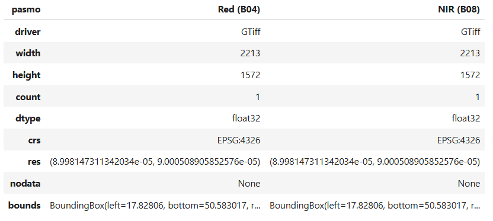

*Rys. 1. Porównanie metadanych pasm B04 i B08.*

### 3. Piksel i współrzędne

Następnie sprawdzono działanie transformacji afinicznej, która umożliwia przeliczanie indeksów piksela na współrzędne geograficzne oraz wykonywanie operacji odwrotnej. Do demonstracji wybrano ręcznie **wiersz 858 i kolumnę 1041**.

Za pomocą `xy()` wyznaczono współrzędne środka piksela: **17,921776° E, 50,647236° N**. Funkcja `rowcol()` zwróciła następnie ten sam wiersz i kolumnę. W wybranym punkcie wartość B04 wyniosła **0,0239**, B08 **0,2494**, a obliczone NDVI około **0,825**.

Piksel oznaczono czerwonym okręgiem na obrazie pasma B04.

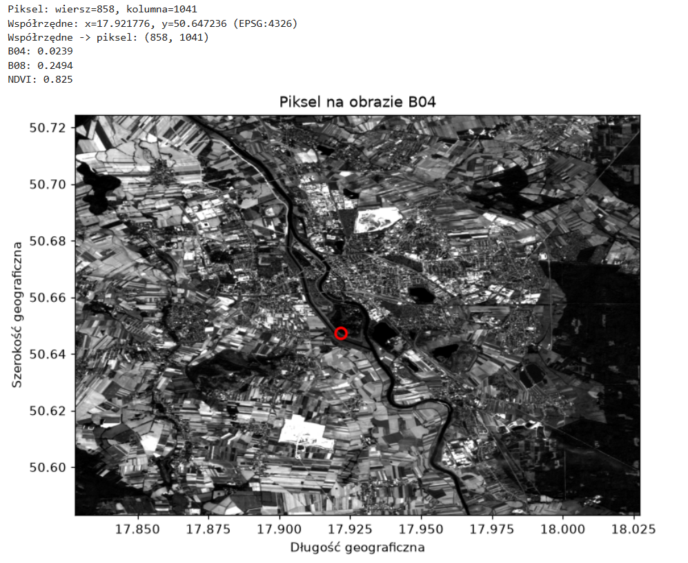

*Rys. 2. Ręcznie wybrany piksel, jego współrzędne i wartości spektralne.*

### 4. Odczyt pasm i statystyki

Dla obu pasm obliczono minimum, maksimum, średnią, medianę i odchylenie standardowe. Wykorzystano funkcje NumPy, m.in. `nanmin()`, `nanmax()`, `nanmean()`, `nanmedian()` i `nanstd()`. Wyświetlono również obrazy obu rastrów w skali szarości oraz histogram porównujący rozkłady wartości odbicia.

| Pasmo | Minimum | Maksimum | Średnia | Mediana | Odch. standardowe |
|---|---:|---:|---:|---:|---:|
| Red (B04) | 0,0000 | 1,5466 | 0,0726 | 0,0615 | 0,0478 |
| NIR (B08) | 0,0030 | 1,5508 | 0,2238 | 0,2160 | 0,0815 |

Średnia wartość odbicia dla **NIR była znacznie większa** niż dla pasma czerwonego. Jest to zgodne z charakterystyką terenów z roślinnością. Oba pasma nie zawierały pikseli oznaczonych jako `NaN` na etapie odczytu.

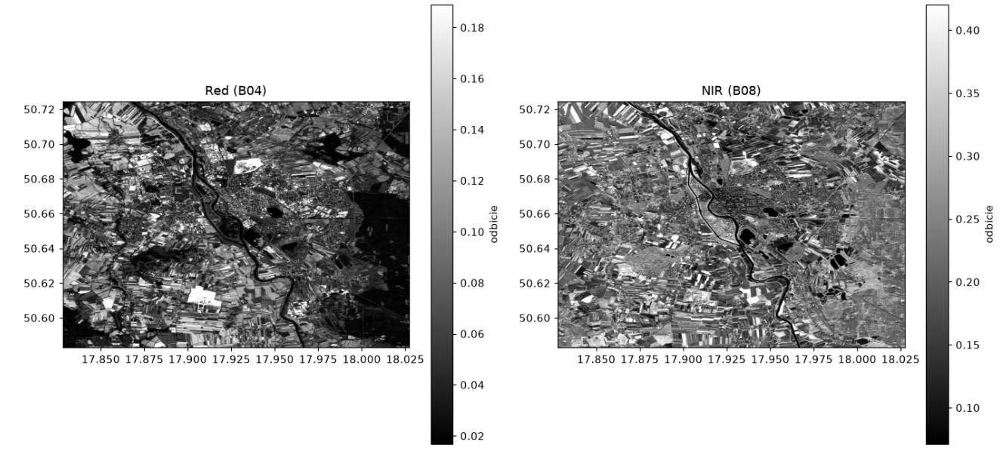

*Rys. 3. Obrazy pasm B04 (Red) i B08 (NIR) w skali szarości.*

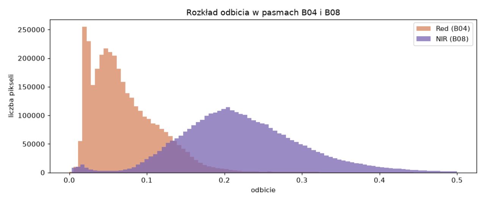

*Rys. 4. Histogram rozkładu wartości odbicia dla obu pasm.*

### 5. Wspólna siatka w metrach

Sprawdzono, czy obydwa pasma mają zgodne układy współrzędnych, rozmiary i transformacje afiniczne. **Siatki wejściowe były identyczne**, co umożliwiło ich wspólne przetwarzanie.

Do dalszych obliczeń rastry przeliczono z układu **EPSG:4326** (stopnie geograficzne) do **EPSG:2180 (PUWG 1992)**, w którym można bezpośrednio obliczać powierzchnię w metrach kwadratowych. Za pomocą `calculate_default_transform()` wyznaczono nową siatkę, a funkcją `reproject()` przeliczono oba pasma z interpolacją dwuliniową (`Resampling.bilinear`).

Po transformacji rastry miały **1430 × 1594 piksele** o rozmiarze **10 × 10 m**.

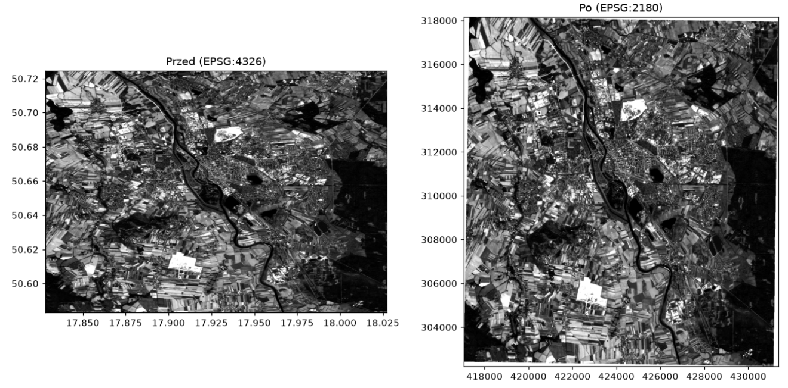

*Rys. 5. Porównanie obrazu B04 przed reprojekcją (EPSG:4326) i po reprojekcji (EPSG:2180).*

### 6. Obliczenie NDVI

Na wspólnej siatce obliczono NDVI według wzoru `(B08 - B04) / (B08 + B04)`. Wyniki nieokreślone, powstające m.in. przy dzieleniu przez zero, pominięto za pomocą `np.ma.masked_invalid()`.

Uzyskano następujące statystyki:

- **Średnie NDVI:** 0,501.
- **Mediana NDVI:** 0,524.
- **Zakres NDVI:** od −0,609 do 0,933.

Wyniki przedstawiono na mapie z paletą barw, w której wartości ujemne oznaczono odcieniami fioletu i niebieskiego, niskie dodatnie — czerwienią i pomarańczem, a wysokie — zielenią. Histogram pokazał, że duża część prawidłowych pikseli miała dodatnie wartości NDVI.

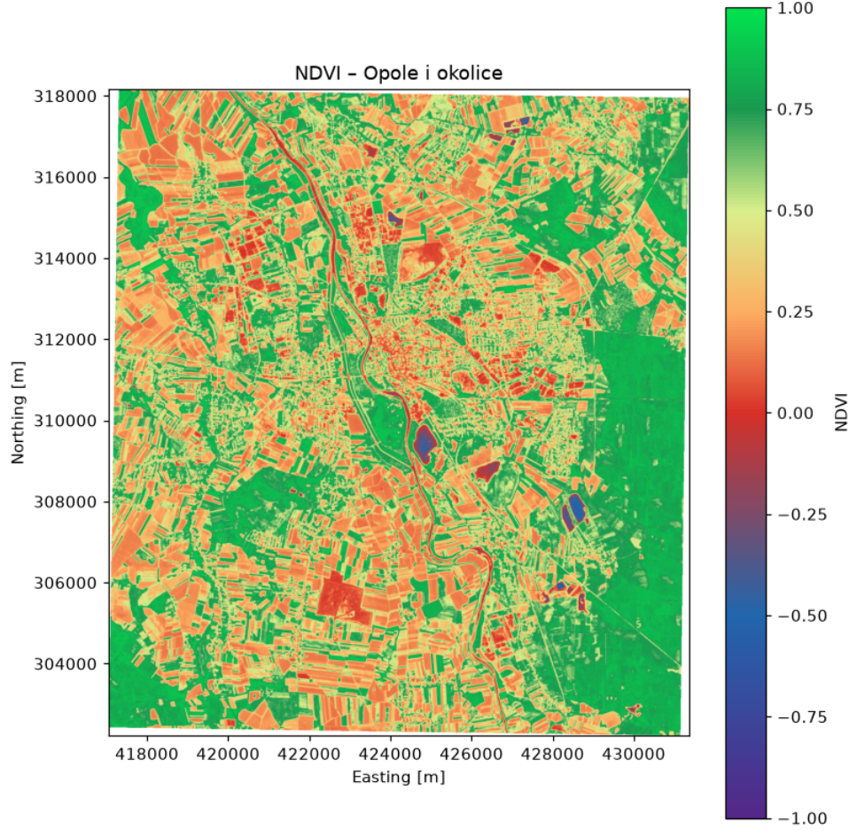

*Rys. 6. Przestrzenny rozkład wskaźnika NDVI dla Opola i okolic.*

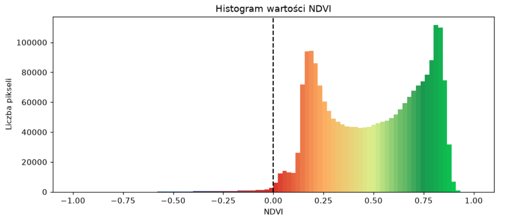

*Rys. 7. Histogram wartości NDVI z kolorami odpowiadającymi wartościom wskaźnika.*

### 7. Klasyfikacja NDVI i powierzchnie

W kolejnym kroku podzielono piksele na cztery klasy za pomocą `np.digitize()`, stosując progi `0`, `0,2` i `0,5`. Liczbę pikseli poszczególnych klas obliczono funkcją `np.bincount()`.

Ponieważ rozdzielczość rastra wynosiła **10 × 10 m**, pojedynczy piksel zajmował **100 m²**, czyli **0,01 ha**.

| Klasa NDVI | Zakres NDVI | Piksele | Powierzchnia [ha] | Udział |
|---|---|---:|---:|---:|
| Woda | < 0 | 17 554 | 175,5 | 0,8% |
| Zabudowa / goła gleba | 0–0,2 | 344 502 | 3 445,0 | 15,6% |
| Rzadka roślinność | 0,2–0,5 | 694 966 | 6 949,7 | 31,4% |
| Gęsta roślinność | ≥ 0,5 | 1 156 675 | 11 566,8 | 52,3% |

**Największy udział miała klasa gęstej roślinności – 52,3% prawidłowych pikseli analizowanej sceny.** Wynik dotyczy całego obrazu satelitarnego, również terenów poza administracyjnymi granicami Opola. Nazwy klas są uproszczoną interpretacją progów NDVI — samo NDVI < 0 nie potwierdza jednoznacznie obecności wody.

Klasyfikację przedstawiono na mapie, a tabelę zapisano w pliku `wyniki/klasy_ndvi.csv`.

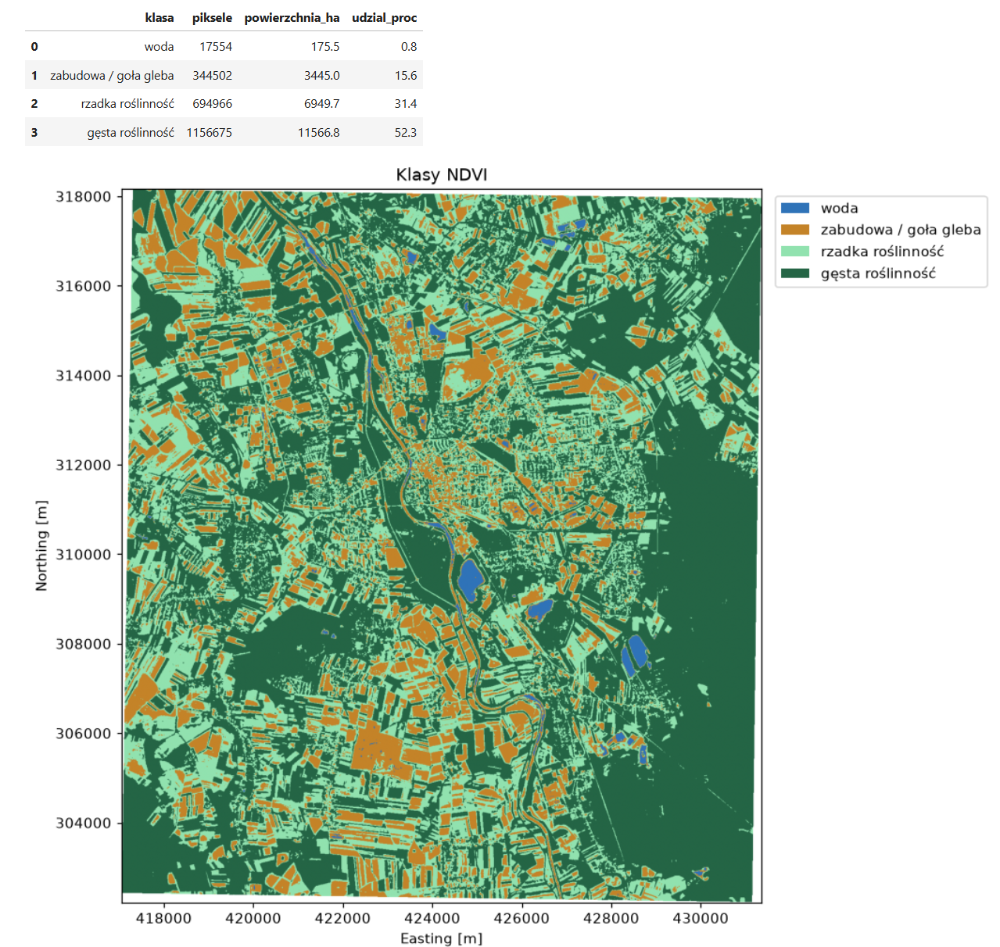

*Rys. 8. Klasy NDVI oraz zestawienie powierzchni i udziałów poszczególnych klas.*

### 8. Statystyki strefowe z GeoPandas

Z pliku `opole_districts.geojson` wczytano **29 poligonów dzielnic Opola**, a następnie przekształcono je do układu EPSG:2180. Raster NDVI umieszczono tymczasowo w pamięci za pomocą `MemoryFile()`. Dla każdego poligonu użyto `rasterio.mask.mask()` do wycięcia odpowiednich pikseli.

Obliczono procent pokrycia każdej dzielnicy dostępnymi pikselami NDVI oraz wartości średnią, minimalną i maksymalną. Aby nie oceniać dzielnic na podstawie zbyt małego fragmentu ich powierzchni, do rankingu włączono tylko obszary z **pokryciem co najmniej 50%**.

Ten warunek spełniły **24 z 29 dzielnic**. Najwyższe średnie wartości NDVI uzyskano dla następujących dzielnic:

| Dzielnica | Pokrycie sceną | Średnie NDVI |
|---|---:|---:|
| Grudzice | 90,5% | **0,710** |
| Nadodrze | 100,0% | **0,661** |
| Chmielowice | 100,0% | 0,544 |
| Zaodrze | 99,9% | 0,541 |
| Malina | 100,0% | 0,539 |

Najniższe średnie NDVI wśród uwzględnionych dzielnic uzyskały **Stare Miasto (0,362)**, **Śródmieście (0,370)** i **Chabry (0,391)**. Wyniki zapisano w pliku `wyniki/statystyki_dzielnic.csv`.

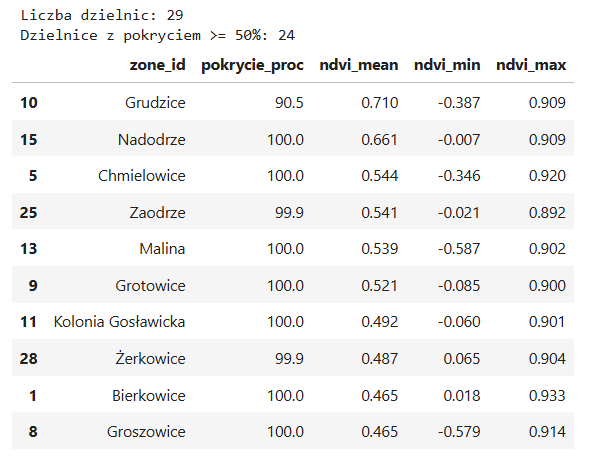

*Rys. 9. Ranking dzielnic Opola według średniej wartości NDVI i ich pokrycia obrazem.*

Na mapie nałożono granice dzielnic na raster NDVI. Kolor poszczególnych dzielnic zależał od ich **średniego NDVI**, a poligony o pokryciu poniżej 50% oznaczono kreskowaniem. Przy dzielnicach zamieszczono ich nazwy i średnie wartości wskaźnika.

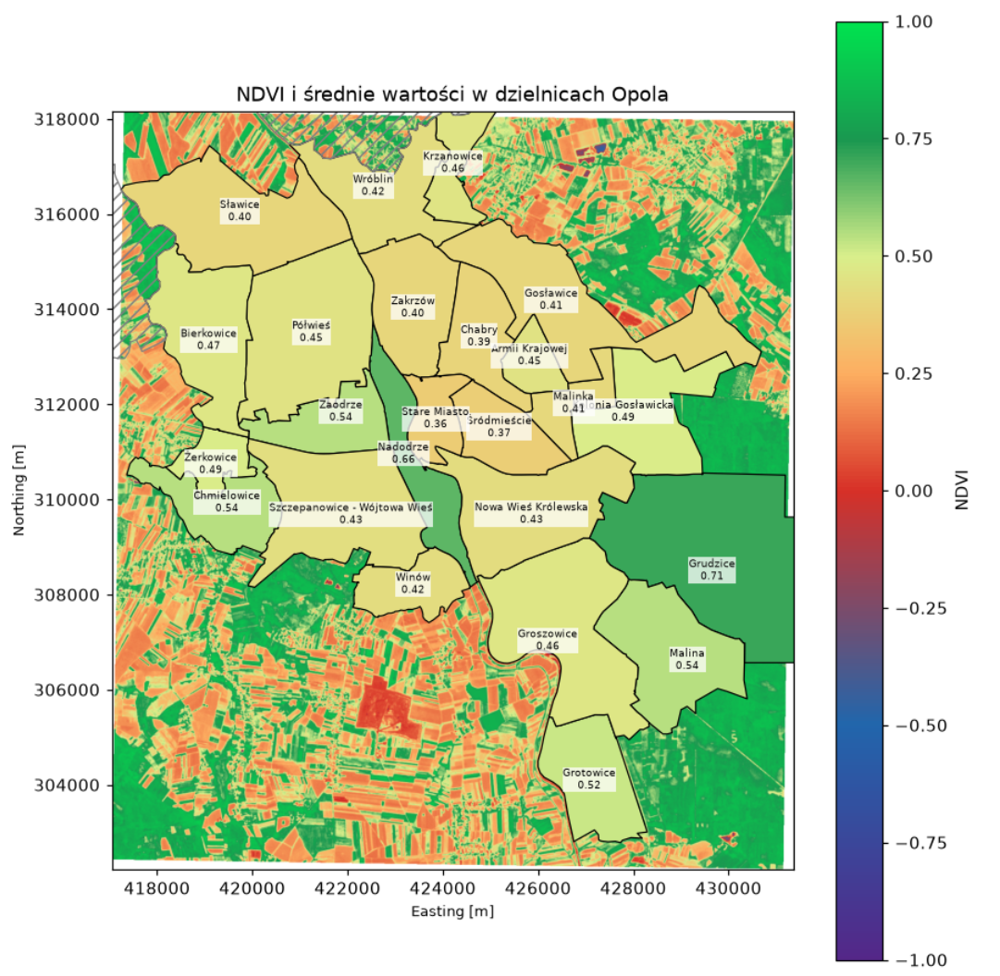

*Rys. 10. Mapa NDVI z granicami dzielnic i ich średnimi wartościami wskaźnika.*

### 9. Zapis wyniku do GeoTIFF

W ostatnim etapie zapisano obliczony raster NDVI do pliku **`wyniki/ndvi.tif`**. Do zapisu wykorzystano `rasterio.open()` w trybie `"w"`, określając jednopasmowy typ danych `float32`, układ współrzędnych EPSG:2180, transformację afiniczną i wartość `nodata = NaN`.

Odczyt zapisanych metadanych potwierdził następujące parametry:

| Właściwość | Wartość |
|---|---|
| Format | GeoTIFF (`GTiff`) |
| Typ danych | `float32` |
| Wymiary | 1430 × 1594 piksele |
| Liczba pasm | 1 (NDVI) |
| CRS | EPSG:2180 |
| Rozdzielczość | 10 × 10 m |
| Brak danych | `NaN` |

Otrzymany plik można otworzyć w programie QGIS i wykorzystać w dalszych analizach przestrzennych. Oprócz rastra zapisano również dwa pliki CSV z klasyfikacją oraz statystykami dzielnic.

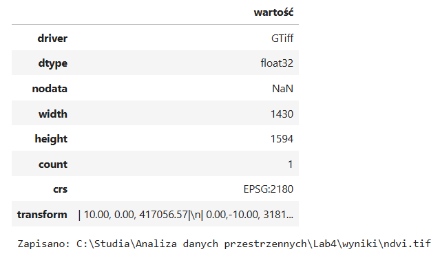

*Rys. 11. Metadane i potwierdzenie zapisu rastra NDVI do GeoTIFF.*

## Wnioski

W ramach laboratorium wykonano kompletną analizę rastrową na podstawie dwóch pasm Sentinel-2 z wykorzystaniem bibliotek Rasterio, NumPy i GeoPandas. Sprawdzono metadane, przeliczono współrzędne pikseli, porównano rozkłady odbicia w pasmach B04 i B08 oraz wykonano reprojekcję rastrów do układu EPSG:2180.

Obliczony wskaźnik NDVI przyjmował wartości od **−0,609 do 0,933**, a jego średnia wyniosła **0,501**. Na analizowanej scenie klasa gęstej roślinności (NDVI ≥ 0,5) zajmowała **11 566,8 ha**, czyli **52,3% powierzchni reprezentowanej przez poprawne piksele**.

Analiza strefowa wykazała, że **najwyższą średnią wartość NDVI miały Grudzice (0,710), a następnie Nadodrze (0,661)**. Najniższe średnie wartości spośród uwzględnionych dzielnic występowały na Starym Mieście i w Śródmieściu. Wyniki wskazują na przestrzenne zróżnicowanie sygnału roślinności pomiędzy dzielnicami Opola.

Ćwiczenie pokazało, jak łączyć analizę rastrową i wektorową w celu oceny przestrzennego rozmieszczenia roślinności oraz jak zapisać rezultaty w formatach GeoTIFF i CSV.