# Laboratorium 5 – Streamlit i YOLO: wykrywanie pojazdów na ortofotomapie

## Cel ćwiczenia

Celem ćwiczenia było przygotowanie aplikacji webowej **Simple Cars Detector**, umożliwiającej wczytywanie ortofotomap w formacie GeoTIFF oraz automatyczne wykrywanie pojazdów za pomocą modelu **YOLO11n-obb**. Aplikację rozwijano etapowo, rozpoczynając od podstawowego interfejsu w Streamlit, a następnie dodając obsługę danych rastrowych, interaktywny podgląd i detekcję obiektów.

W dalszej części ćwiczenia zastosowano podział obrazu na zachodzące na siebie kafelki, aby ograniczyć utratę szczegółów podczas skalowania ortofotomapy. Przygotowano również filtrowanie wykryć według progu pewności oraz przeliczanie współrzędnych pikselowych pojazdów na współrzędne w układzie mapy. W końcowym etapie dodano rozpoznawanie dominującego koloru pojazdów w przestrzeni HSV oraz filtrowanie wyników według wybranych kolorów.

## Wykorzystane narzędzia i dane

- **Python / Visual Studio Code** – przygotowanie i uruchomienie aplikacji
- **Streamlit** – tworzenie interfejsu webowego i przechowywanie wyników w pamięci sesji
- **Rasterio** – odczyt rastrów GeoTIFF, metadanych i transformacji afinicznej
- **NumPy** – przetwarzanie obrazów, podział na kafelki i obliczanie współrzędnych
- **Pillow** – wczytywanie zwykłych obrazów, zmniejszanie i kompresja podglądu
- **Plotly** – interaktywny podgląd ortofotomapy i rysowanie ramek pojazdów
- **pandas** – tworzenie tabel wynikowych
- **OpenCV (`cv2`)** – wyprostowanie obróconych fragmentów obrazu i klasyfikacja kolorów w przestrzeni HSV
- **Ultralytics / PyTorch** – uruchomienie modelu YOLO11n-obb
- **`centrum_10cm.tif`** – ortofotomapa RGB centrum Opola, o rozdzielczości przestrzennej 10 cm
- **ChatGPT** – pomoc w formatowaniu sprawozdania

## Przygotowanie środowiska i uruchomienie

Aby odtworzyć ćwiczenie, należy wykonać następujące czynności:

1. Utworzyć folder `simple_cars_detector` i umieścić w nim plik [app.py](app.py).
2. Pobrać ortofotomapę.
3. Umieścić pobrany plik w podfolderze `data`, np. pod nazwą `centrum_10cm.tif`.
4. Otworzyć folder projektu w Visual Studio Code i w terminalu PowerShell utworzyć środowisko wirtualne oraz zainstalować biblioteki:

   ```powershell
   python -m venv .venv
   .venv\Scripts\activate
   python -m pip install "streamlit>=1.50" ultralytics rasterio plotly pandas pillow opencv-python
   ```

5. Pobrać model i sprawdzić jego klasy:

   ```powershell
   python -c "from ultralytics import YOLO; print(YOLO('yolo11n-obb.pt').names)"
   ```

6. Uruchomić aplikację:

   ```powershell
   streamlit run app.py
   ```

7. Otworzyć stronę `http://localhost:8501`, wgrać ortofotomapę i kliknąć przycisk **Wykrywaj**.
8. Po zakończeniu detekcji zmieniać próg pewności, wybierać jeden lub kilka kolorów pojazdów, przybliżać wybrane fragmenty obrazu oraz sprawdzić tabelę współrzędnych pojazdów.

Oczekiwana struktura katalogów:

```text
simple_cars_detector/
├── app.py
├── README.md
├── yolo11n-obb.pt
├── data/
│   └── centrum_10cm.tif
└── screenshots/
    └── ... (zrzuty ekranu opisane w sprawozdaniu)
```

## Przebieg ćwiczenia

### B1. Strona w Streamlit

W pierwszym etapie utworzono podstawową stronę aplikacji. Za pomocą `st.set_page_config()` ustawiono tytuł, ikonę oraz szeroki układ strony, a funkcjami `st.title()` i `st.write()` dodano nagłówek i opis.

Streamlit wykonuje skrypt od początku przy każdej interakcji użytkownika powodującej ponowne wykonanie aplikacji. Zmianę tekstu w pliku można sprawdzić po zapisaniu kodu i wybraniu opcji **Rerun**. Z tego powodu w kolejnych etapach zastosowano mechanizmy buforowania danych i przechowywania wyników sesji.

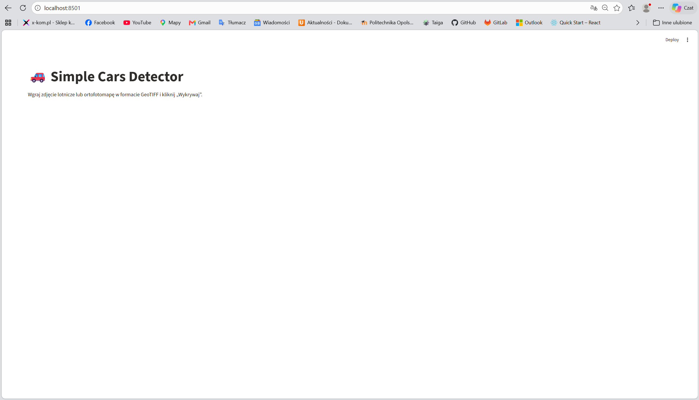

*Rys. 1. Podstawowy interfejs aplikacji Simple Cars Detector.*

### B2. Wczytywanie obrazów

#### 2.1. Wczytywanie zwykłych obrazów

Za pomocą `st.file_uploader()` dodano możliwość wgrywania obrazów PNG i JPG. Bibliotekę Pillow wykorzystano do konwersji obrazu do RGB, a NumPy do zapisania go w tablicy o wymiarach `(wysokość, szerokość, 3)`. Funkcja `st.image()` umożliwiła wyświetlenie obrazu wraz z informacją o jego wymiarach i typie danych.

W teście wczytano zdjęcie JPG o wymiarach **2560 × 1440 px** i typie danych `uint8`.

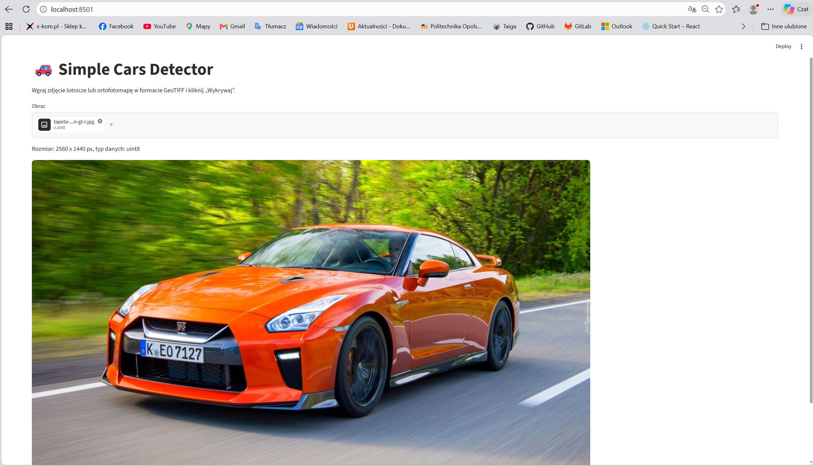

*Rys. 2. Podgląd obrazu PNG lub JPG wraz z jego rozmiarem i typem danych.*

#### 2.2. Wczytywanie GeoTIFF i metadane

W kolejnym kroku zastąpiono obsługę zwykłych zdjęć odczytem plików GeoTIFF. Funkcja `read_geotiff()` wykorzystuje `MemoryFile` z biblioteki Rasterio do otwarcia pliku przesłanego do aplikacji. Odczytywane są maksymalnie trzy pierwsze pasma, a kolejność wymiarów tablicy zmieniana jest z `(pasma, wysokość, szerokość)` na `(wysokość, szerokość, pasma)`.

Dekorator `@st.cache_data` pozwala uniknąć ponownego odczytywania tego samego rastra przy kolejnych interakcjach użytkownika.

Metadane wykorzystanej ortofotomapy:

| Właściwość | Wartość |
|---|---|
| Wymiary | 8000 × 8000 px |
| Liczba pasm | 3 (RGB) |
| Typ danych | `uint8` |
| Układ współrzędnych | EPSG:2180 (PUWG 1992) |
| Rozdzielczość | 0,10 × 0,10 m |
| Wymiary obszaru w układzie mapy | 800 × 800 m |
| Powierzchnia w układzie mapy | 0,64 km² (64 ha) |

Wykorzystano raster udostępniony przez prowadzącego. Zachowano jego oryginalny układ EPSG:2180 bez reprojekcji.

**Jaki obszar obejmuje obraz 8000 × 8000 px przy rozdzielczości 10 cm/piksel i ile pikseli długości ma samochód o długości 4,5 m?**

- Długość boku: `8000 × 0,1 = 800 m`.
- Powierzchnia: `800 × 800 = 640 000 m² = 0,64 km² = 64 ha`.
- Długość samochodu: `4,5 / 0,1 = 45 px`.

Obliczone wartości odnoszą się bezpośrednio do wykorzystanej ortofotomapy.

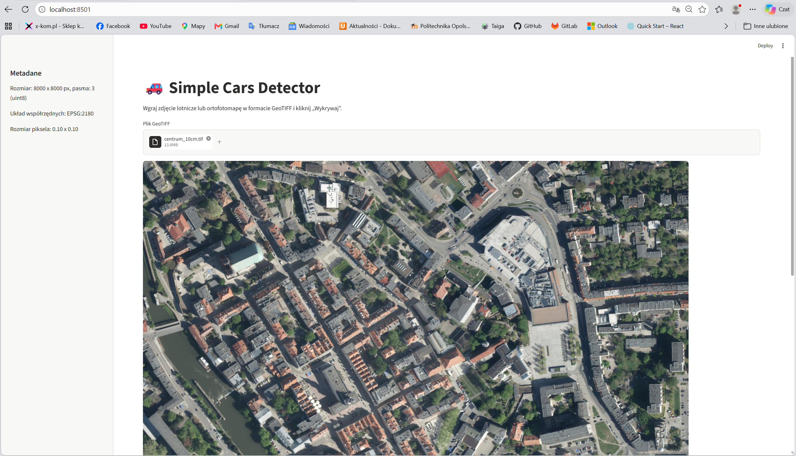

*Rys. 3. Ortofotomapa Opola oraz metadane odczytane z pliku GeoTIFF.*

#### 2.3. Konwersja obrazów do formatu 8-bitowego

Dodano funkcję `to_uint8()`, która przelicza wartości pikseli obrazów o innych typach danych do zakresu 0–255. Do rozciągania kontrastu wykorzystano 2. i 98. percentyl, co ogranicza wpływ skrajnych wartości pikseli.

W przypadku wykorzystanej ortofotomapy konwersja nie zmienia wartości pikseli, ponieważ obraz jest już zapisany jako `uint8`. Funkcja umożliwia jednak obsługę typowych rastrów 16-bitowych i zmiennoprzecinkowych.

#### 2.4. Interaktywny podgląd i współrzędne narożników

Statyczny podgląd zastąpiono wykresem Plotly. Funkcja `image_source()` przygotowuje kopię obrazu o maksymalnym wymiarze 3000 px i zapisuje ją jako JPEG, a `interactive_view()` umożliwia przybliżanie kółkiem myszy, przesuwanie obrazu i powrót do pełnego widoku.

Zmniejszenie dotyczy wyłącznie podglądu. Oryginalny raster pozostaje w pełnej rozdzielczości, dzięki czemu model może analizować szczegóły obrazu. Osie wykresu odpowiadają współrzędnym pikselowym oryginalnej ortofotomapy.

**Czy po przybliżeniu widać pojedyncze samochody?** Tak, na ortofotomapie RGB o rozdzielczości 10 cm/piksel można rozróżnić pojedyncze pojazdy na parkingach. Są one widoczne również na obrazie wynikowym etapu B3. Podgląd Plotly jest jednak pomniejszony, więc dalsze przybliżanie nie zwiększa rzeczywistej ilości szczegółów.

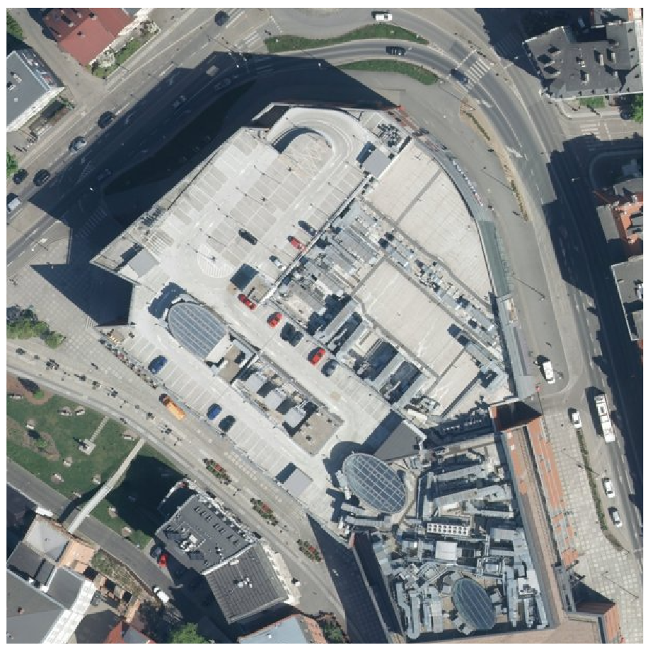

*Rys. 4. Interaktywny podgląd fragmentu ortofotomapy z parkingiem.*

W ramach zadania dodatkowego obliczono współrzędne wszystkich czterech narożników obrazu za pomocą transformacji afinicznej `meta["transform"]`.

| Narożnik | X [m] | Y [m] |
|---|---:|---:|
| Lewy górny | 423584,00 | 312174,00 |
| Prawy górny | 424384,00 | 312174,00 |
| Lewy dolny | 423584,00 | 311374,00 |
| Prawy dolny | 424384,00 | 311374,00 |

Wyniki wyświetlono w panelu bocznym. Współrzędne dotyczą zewnętrznych narożników rastra i są zapisane w jego źródłowym układzie metrycznym.

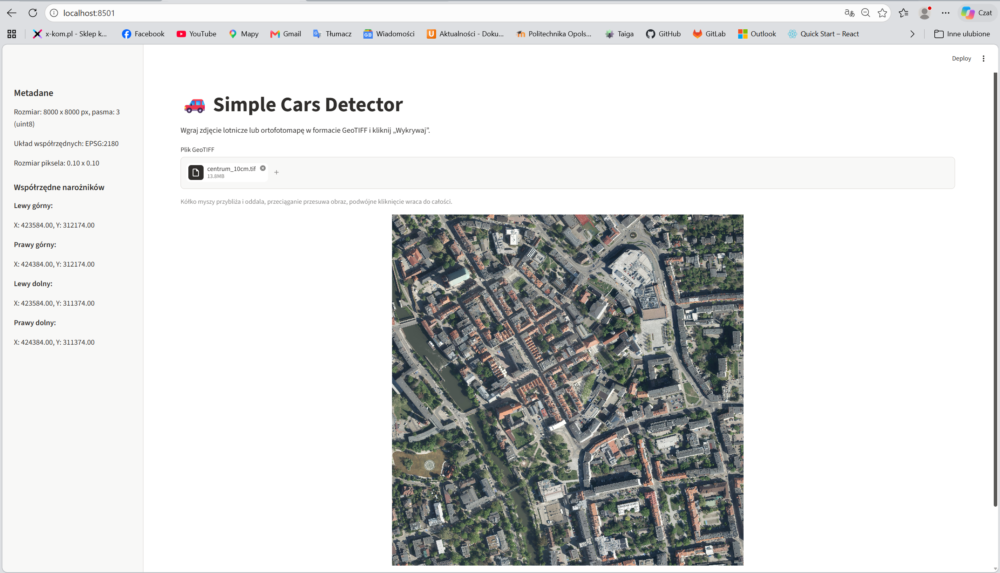

*Rys. 5. Współrzędne czterech narożników ortofotomapy.*

### B3. Dodanie modelu YOLO

#### 3.1. Wybór i ładowanie modelu

Do detekcji wykorzystano **YOLO11n-obb**, czyli niewielki model wytrenowany na zbiorze zdjęć lotniczych DOTA. Wariant OBB (Oriented Bounding Box) zwraca obrócone prostokąty, które lepiej dopasowują się do pojazdów ustawionych pod różnymi kątami niż ramki równoległe do osi obrazu.

Model rozpoznaje 15 klas obiektów, w tym `small vehicle` oraz `large vehicle`. Funkcję `load_model()` oznaczono dekoratorem `@st.cache_resource`, aby model nie był ponownie ładowany przy każdej interakcji z aplikacją. W odróżnieniu od `cache_data`, który przechowuje dane i zwraca kopie wyników, `cache_resource` umożliwia współdzielenie instancji modelu.

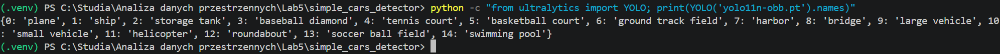

*Rys. 6. Lista klas modelu YOLO11n-obb.*

#### 3.2. Detekcja na całym obrazie

Po kliknięciu przycisku **Wykrywaj** wykonano predykcję na całej ortofotomapie. Przed przekazaniem obrazu do modelu zmieniono kolejność kanałów z RGB na BGR. Próg pewności ustawiono na 0,25, a wyniki przedstawiono w tabeli klas i na obrazie z ramkami.

Uzyskano następujące wyniki:

| Klasa | Liczba wykryć |
|---|---:|
| `small vehicle` | 46 |
| `large vehicle` | 1 |
| `bridge` | 1 |
| **Łącznie** | **48** |

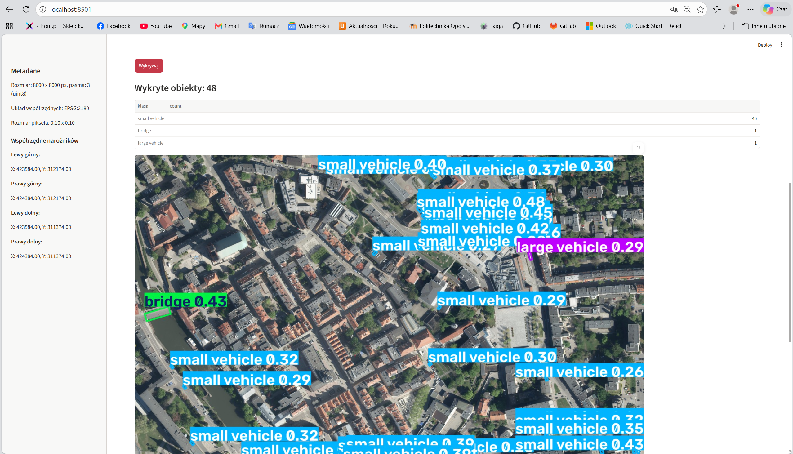

*Rys. 7. Wyniki detekcji na całej ortofotomapie – 46 małych pojazdów, jeden duży pojazd i jeden most.*

**Ile pojazdów znalazł model i dlaczego wynik jest tak niski?** Model wykrył 47 pojazdów, mimo że na parkingach i ulicach widoczne są znacznie liczniejsze samochody. Przyczyną jest skalowanie całego obrazu do rozmiaru wejścia sieci. Dla przykładowego wejścia o dłuższym boku 1024 px samochód o długości 45 px na rastrze o szerokości 8000 px zostaje zmniejszony do około 5,8 px. Utrata szczegółów znacznie utrudnia detekcję małych obiektów. Dokładny rozmiar wejściowy w B3 zależy od ustawień modelu, ponieważ nie określono jawnie parametru `imgsz`.

### B4. Wykrywanie i zaznaczanie pojazdów

#### 4.1. Podział ortofotomapy na kafelki

W celu poprawy wykrywania małych obiektów zastosowano funkcję `tiles()`, dzielącą obraz na kafelki o wymiarach **1024 × 1024 px** z zakładką **128 px**. Krok przesunięcia wynosi `1024 − 128 = 896 px`. Kafelki na krawędziach obrazu mogą być mniejsze.

Zakładka ogranicza ryzyko pominięcia samochodów znajdujących się na granicy kafelków. Dzięki analizie mniejszych fragmentów model zachowuje znacznie więcej szczegółów niż podczas detekcji na całym obrazie.

**Ile kafelków powstanie dla obrazu 8000 × 8000 px?**

Dla każdego wymiaru liczba kafelków wynosi `ceil((8000 − 128) / 896) = 9`, czyli łącznie **9 × 9 = 81 kafelków**.

Tyle samo kafelków powstało w przeprowadzonym ćwiczeniu.

#### 4.2. Detekcja na kafelkach i ograniczanie duplikatów

Funkcja `detect_tile()` wykonuje predykcję dla każdego kafelka z parametrem `imgsz=1024` i minimalnym progiem pewności 0,10. Z wyników pozostawiane są tylko klasy `small vehicle` oraz `large vehicle`.

Parametr `agnostic_nms=True` ogranicza nakładające się wykrycia niezależnie od klasy. Dodatkowo dla sąsiednich kafelków zastosowano warunek uwzględniający położenie środka ramki względem połowy zakładki (64 px). Mechanizm ogranicza wielokrotne zliczanie tego samego pojazdu, choć nie gwarantuje całkowitego usunięcia duplikatów.

Współrzędne narożników ramek przeliczono z lokalnego układu kafelka na współrzędne całego obrazu poprzez dodanie przesunięcia `(col, row)`.

#### 4.3. Pasek postępu i pamięć sesji

Za pomocą `st.progress()` dodano pasek postępu pokazujący numer analizowanego kafelka oraz bieżącą liczbę wykryć. Wyniki zapisano w `st.session_state`, dzięki czemu zmiana ustawień interfejsu nie wymaga ponownego uruchomienia modelu. Wgranie nowego pliku powoduje wyczyszczenie poprzednich wyników.

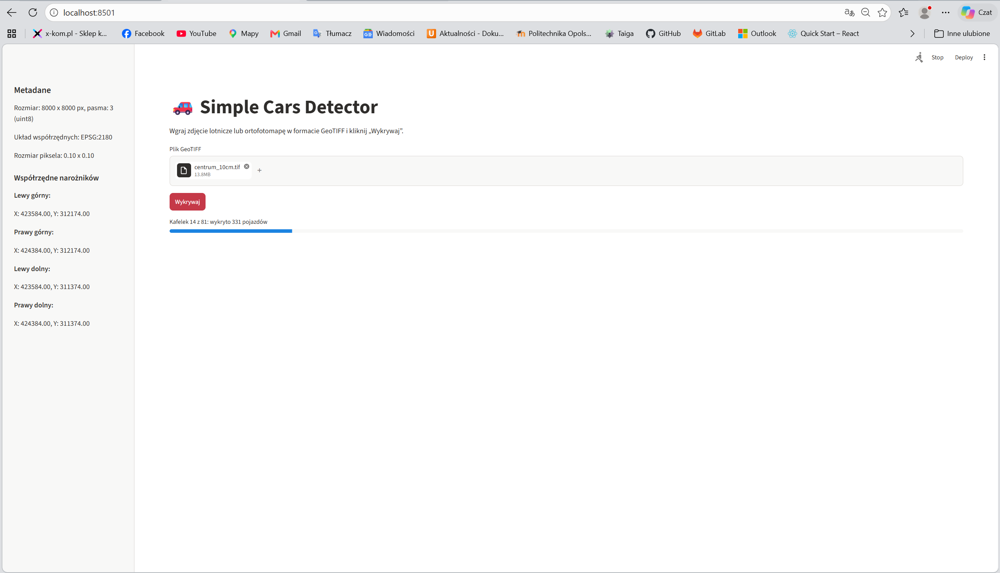

*Rys. 8. Analiza ortofotomapy podzielonej na 81 kafelków; po 14 kafelkach odnotowano 331 wykryć.*

#### 4.4. Rysowanie ramek i filtrowanie wyników

W funkcji `interactive_view()` dodano żółte ramki OBB, rysowane za pomocą `go.Scatter`. Wszystkie ramki umieszczono w jednej serii danych, oddzielając je wartościami `None`. Dodatkowa seria niewidocznych punktów w środkach ramek umożliwia wyświetlenie klasy i pewności po najechaniu kursorem.

Dodano suwak progu pewności od 0,10 do 0,95 z krokiem 0,05 i wartością domyślną 0,25. Zmiana suwaka filtruje wcześniej zapisane wyniki bez ponownego wykonywania detekcji. Wyższy próg pozostawia mniej lub tyle samo wykryć, ograniczając słabe predykcje, ale może również odrzucić prawidłowo wykryte pojazdy.

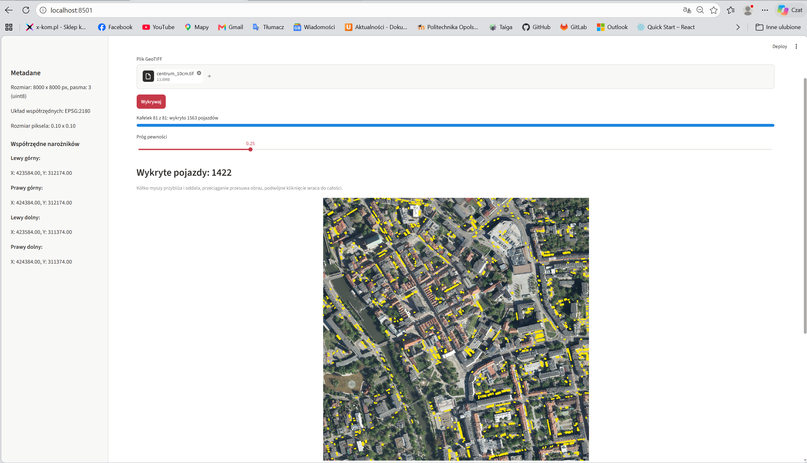

*Rys. 9. Ortofotomapa z 1422 wykryciami pojazdów przy progu 0,25.*

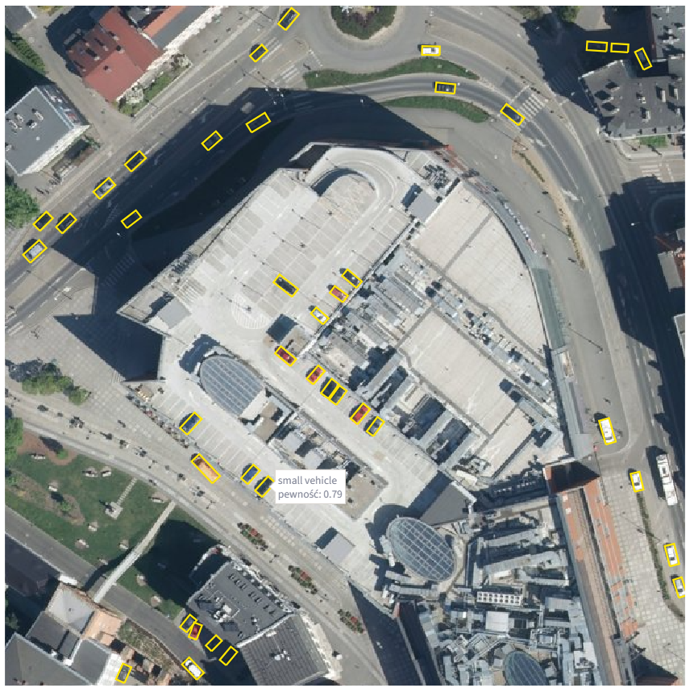

*Rys. 10. Przybliżenie parkingu z ramkami OBB oraz etykietą small vehicle o pewności 0,79.*

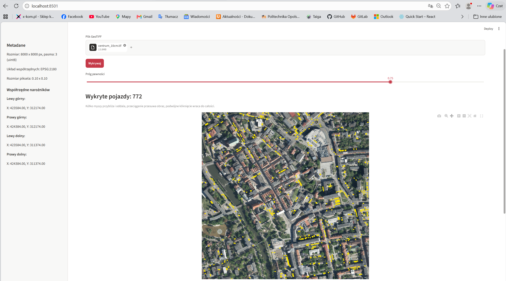

*Rys. 11. Wynik detekcji po zwiększeniu progu pewności do 0,75 (772 pojazdy).*

#### 4.5. Tabela wyników ze współrzędnymi przestrzennymi

Funkcja `results_table()` oblicza środek każdej ramki na podstawie jej czterech narożników. Następnie za pomocą transformacji afinicznej przelicza współrzędne pikselowe na współrzędne w układzie mapy.

Tabela zawiera klasę pojazdu, pewność wykrycia, kolumnę i wiersz środka ramki oraz współrzędne X i Y w źródłowym układzie ortofotomapy. Do obliczeń współrzędnych zastosowano typ `float64`, aby ograniczyć utratę precyzji.

Przykładowe wykrycie klasy `small vehicle` o pewności 0,82 miało środek w kolumnie 177 i wierszu 605 (wartości zaokrąglone), a współrzędne w EPSG:2180 wynosiły X = 423601,67 m oraz Y = 312113,49 m.

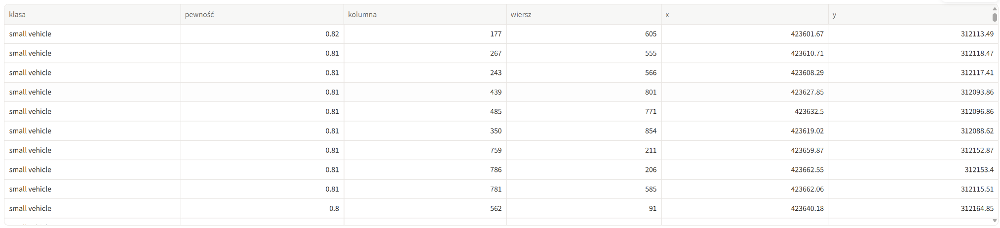

*Rys. 12. Tabela wykrytych pojazdów wraz z pewnością i współrzędnymi przestrzennymi.*

#### 4.6. Porównanie wyników detekcji

| Parametr | Detekcja na całym obrazie (B3) | Detekcja kafelkowa (B4) |
|---|---|---|
| Liczba analizowanych fragmentów | 1 | 81 |
| Wykrywane klasy | Wszystkie klasy DOTA | Małe i duże pojazdy |
| Próg pewności | 0,25 | 0,25 (domyślnie) |
| Liczba wykrytych pojazdów | 47 | **1422** |
| Interaktywne ramki OBB | Nie | Tak |
| Współrzędne pojazdów w układzie mapy | Nie | Tak |

Wyniki filtrowania detekcji kafelkowej:

| Próg pewności | Liczba wykrytych pojazdów |
|---|---:|
| 0,10 | 1563 |
| 0,25 | 1422 |
| 0,50 | 1223 |
| 0,75 | 772 |
| 0,95 | 0 |

Przy progu 0,25 detekcja kafelkowa zwróciła **1422 wykrycia pojazdów**, czyli około 30,26 razy więcej niż detekcja na całym obrazie (47 pojazdów). Wynik jest zbliżony do 1423 pojazdów uzyskanych przez autora instrukcji. Zwiększenie progu z 0,25 do 0,75 zmniejszyło liczbę wykryć o 650 (45,7%). Przy progu 0,95 nie pozostało żadne wykrycie. Zmiana progu nie wymagała ponownej predykcji. Bez ręcznie oznaczonych danych referencyjnych nie można na podstawie samej liczby wykryć obliczyć dokładności modelu.

### B5. Rozpoznawanie i filtrowanie kolorów pojazdów

#### 5.1. Rozpoznawanie koloru

W celu realizacji filtrowania według koloru rozszerzono aplikację o funkcję `vehicle_color()`, wykorzystującą bibliotekę OpenCV. Model YOLO11n-obb nadal odpowiada za detekcję pojazdów, natomiast ich kolor określany jest niezależnie na podstawie pikseli oryginalnej ortofotomapy RGB.

Dla każdego wykrytego pojazdu wycięto fragment obrazu obejmujący jego ramkę OBB. Za pomocą `cv2.getPerspectiveTransform()` i `cv2.warpPerspective()` przekształcono obróconą ramkę do prostokątnego obrazu. Pominięto zewnętrzne 10% z każdej strony wycinka, aby ograniczyć wpływ pikseli jezdni i otoczenia pojazdu.

Następnie funkcją `cv2.cvtColor()` przekształcono obraz z RGB do przestrzeni **HSV (Hue, Saturation, Value)**, w której odcień, nasycenie i jasność są reprezentowane oddzielnie. Na podstawie progów wartości tych składowych przypisano piksele do kategorii kolorystycznych i wyznaczono dominujący kolor.

Uwzględniono dziewięć kolorów: biały, czarny, szary, czerwony, niebieski, zielony, żółty, pomarańczowy i brązowy. Dodano również kategorię `Nieokreślony`. Jest ona stosowana m.in. wtedy, gdy dominująca kategoria obejmuje mniej niż 35% analizowanych pikseli lub jej przewaga nad drugą kategorią jest mniejsza niż 8 punktów procentowych. Kolor zapisywany jest w słowniku każdego wykrytego pojazdu razem z klasą, pewnością i współrzędnymi ramki.

#### 5.2. Filtrowanie wyników według koloru

Za pomocą `st.multiselect()` dodano możliwość wyboru jednego lub kilku kolorów pojazdów. Domyślnie wybrane są wszystkie kategorie, dzięki czemu filtr nie ogranicza początkowych wyników detekcji. Warunek filtrowania uwzględnia zarówno próg pewności, jak i wybrane kolory:

```python
shown = [b for b in boxes if b["score"] >= conf and b["color"] in selected_colors]
```

Wyniki wraz z przypisanymi kolorami są przechowywane w `st.session_state`. Zmiana filtra nie wymaga ponownego uruchamiania modelu YOLO ani ponownego rozpoznawania kolorów. Aktualizowane są liczba wyświetlanych pojazdów, ramki na ortofotomapie i tabela wyników.

Przeprowadzono test dla progu pewności 0,25, wybierając wyłącznie kategorię `Czerwony`.

| Parametr | Wynik |
|---|---:|
| Próg pewności | 0,25 |
| Liczba wykryć bez ograniczenia koloru (B4) | 1422 |
| Liczba wykryć zaklasyfikowanych jako czerwone | **49** |
| Udział względem wyniku B4 | 3,45% |

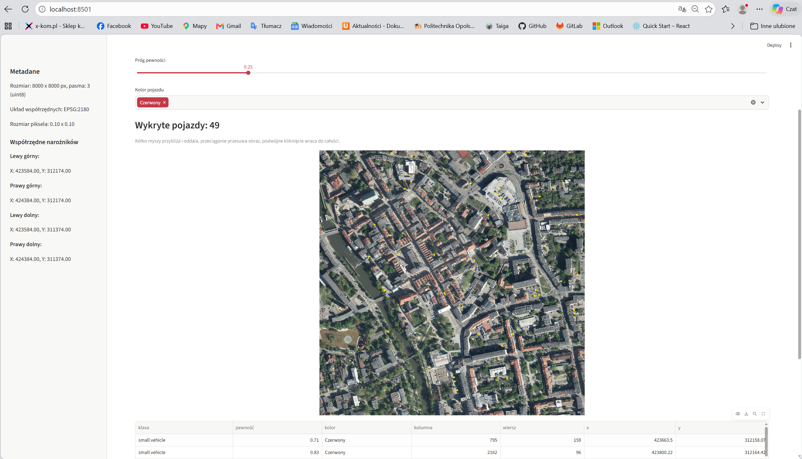

*Rys. 13. Wynik filtrowania według koloru czerwonego przy progu pewności 0,25 – 49 pojazdów.*

#### 5.3. Wizualizacja i tabela wyników

Rozbudowano funkcję `interactive_view()` tak, aby po najechaniu kursorem na środek ramki wyświetlana była również informacja o rozpoznanym kolorze. Na przybliżonym fragmencie parkingu widoczne są ramki wokół czerwonych samochodów, podczas gdy pojazdy innych kolorów pozostają bez zaznaczenia. Przykładowy pojazd klasy `small vehicle` został wykryty z pewnością 0,76 i zaklasyfikowany jako czerwony.

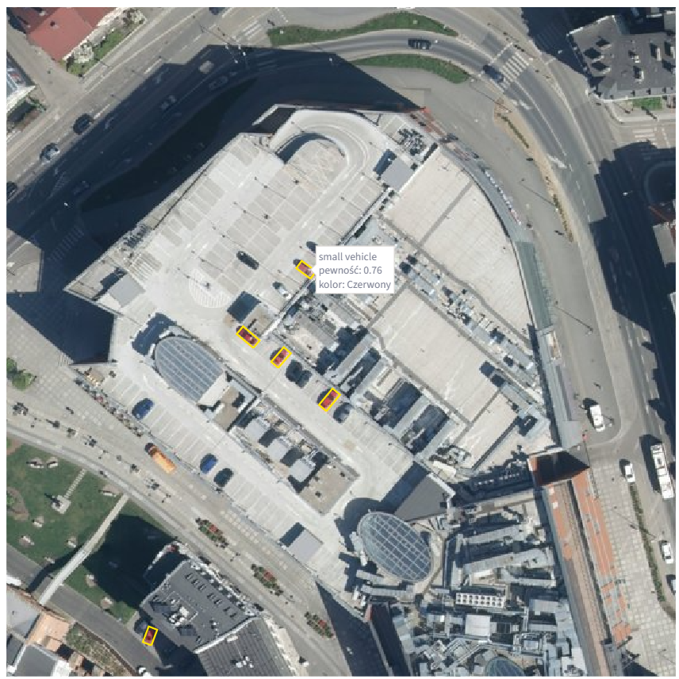

*Rys. 14. Przybliżenie parkingu z zaznaczonymi czerwonymi pojazdami oraz etykietą klasy, pewności i koloru.*

Funkcję `results_table()` rozszerzono o kolumnę `kolor`. Tabela przedstawia tylko pojazdy spełniające aktualne warunki filtrowania. Przykładowy czerwony pojazd klasy `small vehicle` o pewności 0,71 miał środek w kolumnie 795 i wierszu 159, a jego współrzędne w EPSG:2180 wynosiły X = 423663,50 m i Y = 312158,07 m.

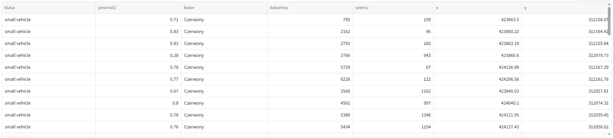

*Rys. 15. Tabela wykrytych pojazdów po wybraniu koloru czerwonego.*

Rozpoznawanie kolorów ma charakter heurystyczny. Cienie, odbicia światła, szyby i piksele otoczenia mogą wpływać na wynik klasyfikacji. Wizualna kontrola wybranego parkingu potwierdziła działanie filtra.

## Wnioski

W ramach ćwiczenia przygotowano aplikację webową łączącą przetwarzanie danych rastrowych z detekcją obiektów za pomocą modelu YOLO11n-obb. Wykorzystano ortofotomapę RGB przedstawiającą fragment Opola o wymiarach **8000 × 8000 px** i rozdzielczości przestrzennej **10 cm/piksel**.

Detekcja na całym obrazie pozwoliła wykryć 48 obiektów, w tym **47 pojazdów**. Pokazuje to ograniczenia związane ze skalowaniem dużych obrazów przed przekazaniem ich do sieci neuronowej.

W celu ograniczenia tego problemu raster podzielono na **81 zachodzących na siebie kafelków**. Przy progu pewności 0,25 uzyskano **1422 wykrycia pojazdów**, czyli ponad 30 razy więcej niż podczas analizy całego obrazu. Zastosowano ramki OBB, filtrowanie według progu pewności oraz wyznaczanie współrzędnych pojazdów w układzie EPSG:2180. Zwiększanie progu zmniejszało liczbę wyświetlanych wykryć, aż do zera przy wartości 0,95.

W ostatnim etapie zastosowano analizę kolorów w przestrzeni HSV oraz filtrowanie według jednej lub kilku kategorii kolorystycznych. Przy progu pewności 0,25 po wybraniu koloru czerwonego aplikacja wyświetliła **49 pojazdów zaklasyfikowanych jako czerwone**. Wyniki można filtrować bez ponownego wykonywania detekcji, a przypisany kolor jest widoczny w etykietach i tabeli współrzędnych.

Ćwiczenie pokazało możliwości połączenia danych geoprzestrzennych z metodami głębokiego uczenia i klasycznego przetwarzania obrazów oraz przedstawienia wyników analizy w interaktywnej aplikacji webowej. Zrealizowano kroki B1–B4 instrukcji oraz dodano filtrowanie według koloru pojazdów w dodatkowym etapie B5.